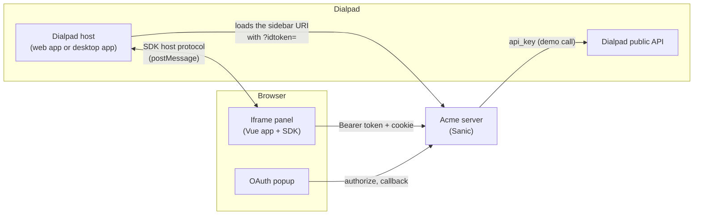
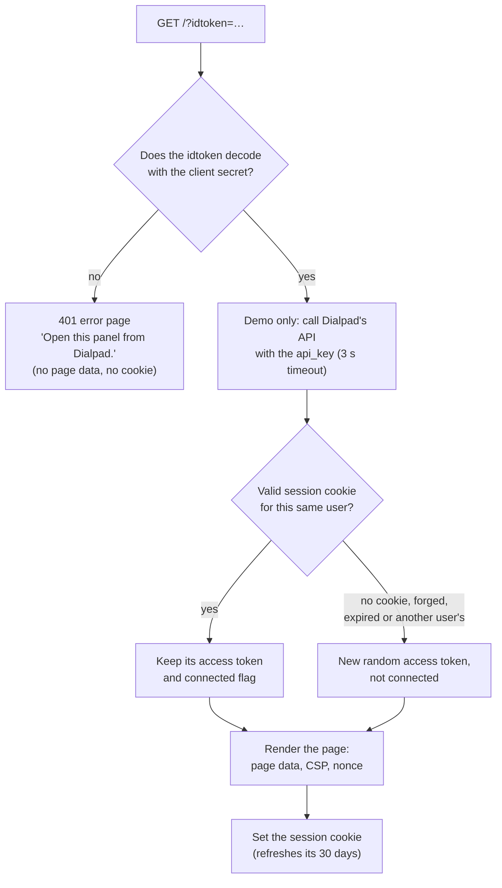
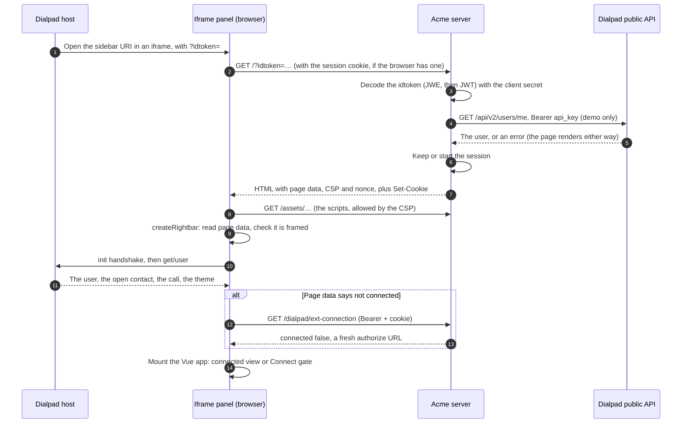
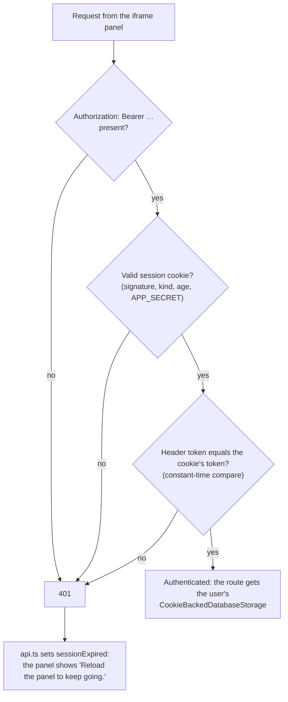
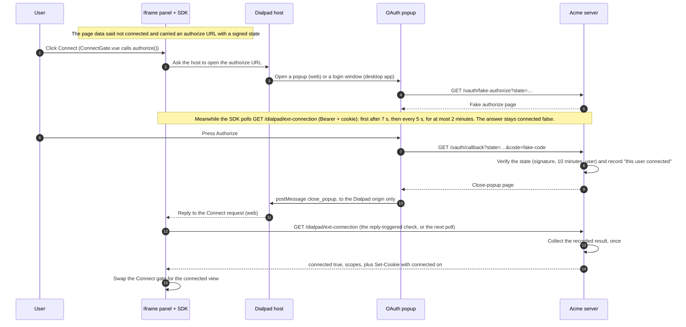
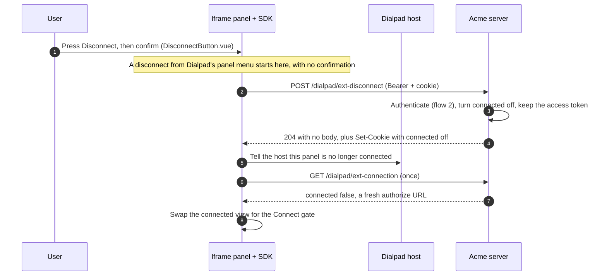
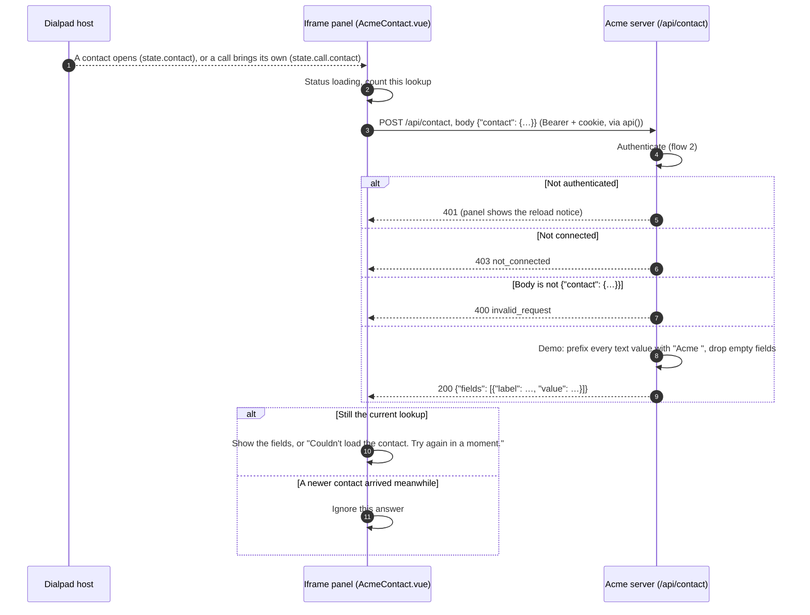
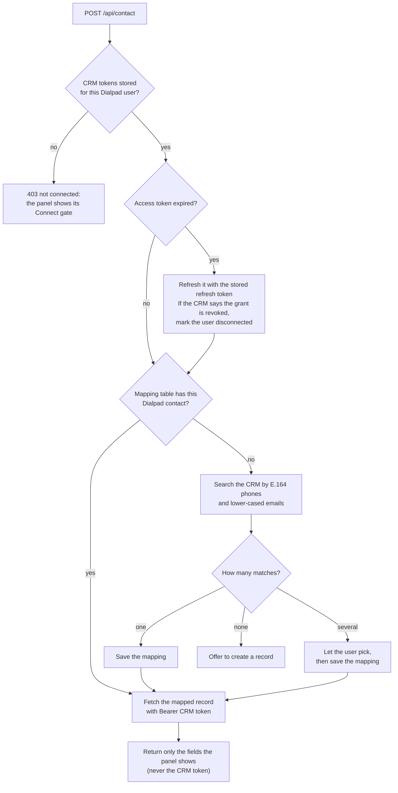

# The flows, one at a time

How the Acme CRM reference app behaves, flow by flow, with a diagram for each. The
[README](README.md) says how to install, run and adapt it; this document says what
happens when it runs. Each flow names the files that do the work and says what the
demo fakes and what a real app would do instead.

1. [Initial iframe page load](#1-initial-iframe-page-load)
2. [Authenticating every request from the iframe panel](#2-authenticating-every-request-from-the-iframe-panel)
3. [External OAuth (Connect)](#3-external-oauth-connect)
4. [External disconnect](#4-external-disconnect)
5. [External contact pulling](#5-external-contact-pulling)
6. [Everything else the demo does](#6-everything-else-the-demo-does)

Paths are relative to `server/acme_crm/` (Python) and `client/src/` (TypeScript).

## The pieces

Where the demo keeps what it has to remember:

| What                                                | Where                                                                     | Lasts                     | Why                                                                       |
| --------------------------------------------------- | ------------------------------------------------------------------------- | ------------------------- | ------------------------------------------------------------------------- |
| The user's access token, and whether they connected | Signed session cookie `__Host-acme_session` (`database.py`, `signing.py`) | 30 days, per browser      | The demo has no database, so the cookie is its storage                    |
| The OAuth round trip's user and expiry              | Signed `state` in the authorize URL (`signing.py`)                        | 10 minutes                | Lets the callback know which Dialpad user is connecting                   |
| "This user just pressed Authorize"                  | `OAuthResults` in server memory (`stores.py`)                             | 5 minutes, collected once | The popup cannot set the iframe's cookie (flow 3)                         |
| The idtoken and its `api_key`                       | Nowhere: used on the page request, then dropped                           | One request               | A real app persists the key; see [flow 1](#the-demo-call-to-dialpads-api) |

A real app keeps all of this in its database: a session row, the CRM tokens its
OAuth callback received, and the Dialpad `api_key`. The README's
[Security section](README.md#security-what-the-demo-shows) explains the choices.

---

## 1. Initial iframe page load

Dialpad opens the OAuth app's conversation sidebar URI in an iframe and appends
`?idtoken=<token>`. This is the only request authenticated by the idtoken. It
starts the session that every later request uses.

### On the server (`endpoints/dialpad/page.py`)

The page data holds only what the iframe panel needs: the Dialpad origin, the API
prefix, the **access token**, the `external_connection` (connected or not, one
authorize URL for the `acme-crm` client, its scopes) and the demo's `app` field.
No user profile and no `api_key` reach the browser.

### From Dialpad to a working panel

What the browser does with it (`bootstrap.ts`):

1. `createRightbar({ heightRoot, fetch: api })` starts the SDK, which reads the
   page data and refuses to run unless the page is inside an iframe. It then
   talks only to the page data's `dialpad_origin`.
2. If the SDK refuses (`bad_options`, `not_framed`, `bad_page_data`,
   `init_timeout`) the page is not in a working Dialpad iframe, so
   `BootstrapError.vue` shows "Open this panel from Dialpad" and nothing else
   runs.
3. Otherwise the Dialpad theme is applied, the SDK's `authHeaders()` are handed
   to `api.ts`, and `App.vue` mounts. It shows `ConnectedView` when the SDK's
   `connection.connected` is true and `ConnectGate` otherwise.

When the cookie says the user is connected, the very first paint is already the
connected view, even after a server restart, because the page data came from the
cookie.

### Returning visits and resets

| Situation                                                   | Result                                                                                                       |
| ----------------------------------------------------------- | ------------------------------------------------------------------------------------------------------------ |
| Valid cookie, same user                                     | Same access token, same connection state, cookie refreshed                                                   |
| No cookie (first visit, cleared, or the browser rejects it) | New token, not connected. A browser that rejects it gets `401` on every call and the panel asks for a reload |
| Cookie for a different Dialpad user (shared browser)        | New token, not connected. The other user's open panel gets `401`                                             |
| Forged or expired cookie                                    | Treated as no cookie                                                                                         |
| `APP_SECRET` changed                                        | Every cookie fails verification: everyone starts over                                                        |
| Server restarted                                            | Nothing is lost: the state is in the cookie                                                                  |

### The demo call to Dialpad's API

**Unnecessary for the app, and for demo purposes only.** While it renders the
page, the server uses the idtoken's `api_key` to call Dialpad's public API, to
show how the key is used: `GET {DIALPAD_ORIGIN}/api/v2/users/me` with
`Authorization: Bearer <api_key>`, made by Dialpad's own Python client
([`python-dialpad`](https://pypi.org/project/python-dialpad/)), in
`dialpad_api.py`. The iframe panel shows the user's name, email, id and state in
a "From Dialpad's API" card (`DialpadApiCard.vue`, fed by `customPageAppData.ts`).

- The call has a 3 second timeout and no retry. If Dialpad's API refuses the
  key, fails or is slow, the page renders anyway and the card says "Dialpad API
  unavailable".
- Local mode makes no call (the mock idtoken's key isn't real), and the card
  says so.
- The key is used for this one call and dropped. It is never put in the page,
  logged or returned, and the idtoken is not stored.
- Doc 11 of the partner rightbar PRD lists calling the public API with the key
  as out of scope; this demo does it anyway, to show the key in use.

A real application would not work this way. The key never expires, so it
**persists the api key in long-term storage** (as it does its CRM tokens) the
first time it sees it, and **uses it to call Dialpad as and when needed**, from
a background job or a webhook handler as much as from a page load.

---

## 2. Authenticating every request from the iframe panel

The iframe has no idtoken, so every request it makes after the page load proves
itself with the access token the page handed out, **twice**: as a header the panel's
own code adds, and as the session cookie the browser adds. This covers the two
requests the SDK makes itself (`ext-connection` and `ext-disconnect`, the only
ones it invokes) and every route the application adds, such as `/api/contact`.

- **Browser side (`api.ts`).** The one `api()` function wraps `fetch`, adds the
  SDK's `authHeaders()` (`Authorization: Bearer <access token>`) and, on a `401`,
  sets `sessionExpired`. It is passed to the SDK as `fetch`, so the SDK's own
  calls go through it too, and the app's routes use it the same way.
- **Server side (`context.py`).** `AppContext.state_for(request)` does the check
  above and returns the user's state, or `None`; each route answers `unauthorized()`
  for `None`. The route then knows who is asking from `state.user_key()`, never
  from the idtoken.
- **Why both.** The cookie must be `SameSite=None` (the panel is in a third-party
  iframe), so browsers also attach it to requests made by other sites. Only code
  that holds the page data knows the token to put in the header, so a cross-site
  request cannot forge it (the "double submit" defence against CSRF).

A real app can use any token the panel can send (a signed JWT, a session-table id);
the contract only needs _some_ token.

---

## 3. External OAuth (Connect)

The user connects their Acme account. The OAuth here is **fake**: a page labelled
fake, with an Authorize button, stands in for the CRM's consent screen.

Files: `ConnectGate.vue` (the gate), `fake_oauth.py` and
`endpoints/app/oauth_fake_authorize.py` (the fake consent page),
`endpoints/app/oauth_callback.py` (the callback), `endpoints/dialpad/ext_connection.py`
(the check), `stores.py` (the note), `signing.py` (the `state`).

What the user sees while it runs: "Waiting for you to finish connecting in the
Acme window…" with the button disabled. Like the desktop app, the local dev host
never replies to Connect, so there the polling completes the flow.

### When it goes wrong

| What happens                                                            | Result                                                                                              |
| ----------------------------------------------------------------------- | --------------------------------------------------------------------------------------------------- |
| The `state` is forged, expired (over 10 minutes) or the `code` is wrong | The callback renders an error page (`400`) and records nothing                                      |
| The user never presses Authorize                                        | The SDK gives up after 2 minutes; the gate says "Acme didn't respond in time." with **Try again**   |
| The connection check fails (network, non-`2xx`)                         | The gate shows the matching message (`network`, `request_failed`) with **Try again**                |
| The user presses Authorize after the SDK gave up                        | The note waits 5 minutes; the next check (a retry, or the next page load's start check) collects it |
| The access token is rejected (`401`)                                    | "Reload the panel to keep going." (flow 2)                                                          |

### Why a note is kept in server memory (demo only)

The callback and the iframe panel are different windows. The callback runs in the
popup, and the session cookie belongs to the iframe panel (it is `Partitioned`), so
the callback cannot set it. The only thing both sides know is which Dialpad user
this is, so the callback leaves a short-lived note in server memory ("this user
finished connecting", kept for 5 minutes and collected once), and the iframe
panel's next check picks it up. That note is `OAuthResults` in `stores.py`, whose
docstring tells the whole flow.

**This exists only because the demo has no real CRM.** A real partner's callback
exchanges the `code` for CRM tokens and stores them durably, keyed by the Dialpad
user, and `ext-connection` answers "connected" when those tokens exist, from the
database, on any instance and after any restart. Then there is no handoff and no
expiry, and both `OAuthResults` and the cookie can go.

Without a database, this demo keeps what has to last, the user's access token and
"this user is connected to external CRM", in the browser: the signed, 30-day
session cookie is its persistent storage. It survives a server restart or
scale-to-zero, and it is signed so it can't be forged. The cookie is not encrypted
(it is `HttpOnly`, so page scripts can't read it), it is per browser, a browser
that refuses it can't use the iframe panel, and the server can't revoke one early.
A real partner's stored tokens, looked up by Dialpad user, have none of those
limits.

### What a real app does differently

1. The authorize URL points at the **CRM's** authorize endpoint, with your client
   id, redirect URI, scopes and a `state` you can verify (random, stored with the
   Dialpad user, short expiry).
2. The callback verifies the `state`, **exchanges the `code` for the CRM's access
   and refresh tokens** at the CRM's token endpoint, and stores them durably, keyed
   by the Dialpad user.
3. `ext-connection` answers from the database: connected when valid tokens exist.

---

## 4. External disconnect

The user ends the connection, from the **Disconnect** button in the panel or from
Dialpad's own panel menu. Both take the same path inside the SDK; the menu skips
the panel's confirmation.

Files: `DisconnectButton.vue`, `endpoints/dialpad/ext_disconnect.py`.

- **The cookie keeps its access token.** Only the `connected` flag changes,
  because the SDK's next call (`ext-connection`) must still authenticate.
- **If the call fails** the user stays connected and sees "We couldn't
  disconnect Acme. Try again." above the button.
- **Per browser.** The demo's connection lives in the browser's cookie, so
  disconnecting changes it only in the browser that asked. A real app deletes the
  user's CRM tokens here, which disconnects them everywhere. Revoke the grant at
  the CRM too if it has a revocation endpoint.

---

## 5. External contact pulling

Dialpad tells the iframe panel which contact is open, but that is **Dialpad's**
contact: a name, phones and emails from Dialpad's directory. What a partner's panel
exists to show is the partner's own record for that person. Getting from one to the
other is the **contact mapping**, and it happens on the server because it needs the
user's CRM credentials.

Files: `AcmeContact.vue` (the lookup and its four states), `contactApi.ts` (the
request and the answer's shape check), `endpoints/app/contact.py` (the route).

**What the demo does.** There is no CRM, so there is no mapping. The server
answers with every non-empty field of the Dialpad contact: text is prefixed
`Acme `, a list is prefixed element by element and joined with commas, any other
value is shown as JSON, and empty fields (`None`, `''`, `[]`) are left out (zero and
`false` are kept). That proves the contact reached the server and came back, and
that the request was authenticated as the right user.

**Two contacts during a call.** `ConnectedView.vue` shows the panel's contact and,
when the active call's contact is a different person (`isSameContact` in
`contacts.ts`), the call's contact as a second section. Usually they are the same
person and one section is enough.

**What a real app would do** in that route, after authenticating the request:

1. **Check the connection and get the CRM token.** None means not connected
   (`403`). Refresh an expired token with the stored refresh token, and mark the
   user disconnected if the CRM says the grant was revoked.
2. **Map the Dialpad contact to a CRM record.** Look in your own mapping table
   (Dialpad contact id to CRM record id) first. Otherwise search the CRM by the
   contact's phone numbers and emails, normalised to the form the CRM stores, and
   decide what zero, one and several matches mean. Save the choice.
3. **Fetch the mapped record** with `Authorization: Bearer <CRM access token>` and
   return only the fields the panel shows.
4. **Tell Dialpad about the match.** When the panel has the record it calls the
   SDK's `linkRecord(...)`, so Dialpad can offer "View record" in the panel menu
   and use the record's URL for screen pops when a call comes in.
5. **Handle the CRM being slow or down** with a short timeout and an error the
   panel can show.

The demo does not call `linkRecord`; it is described here and in the comments of
`contact.py` and `AcmeContact.vue` only.

---

## 6. Everything else the demo does

The four flows above are what a partner copies. The demo also does these, mostly
around them:

| Behaviour                                | How it works                                                                                                                                                                                                                                                                                                                                        |
| ---------------------------------------- | --------------------------------------------------------------------------------------------------------------------------------------------------------------------------------------------------------------------------------------------------------------------------------------------------------------------------------------------------- |
| **Host events after start**              | The SDK keeps `state` current from Dialpad's events: the open contact, the call (ringing, connected, ended, a new call), and the light or dark theme. `bootstrap.ts` follows the theme; `CallCard.vue` and `AcmeContact.vue` follow the call and contact. Connecting does not reset them                                                            |
| **Opened outside Dialpad**               | The SDK's `not_framed` check fails, and the page says "Open this panel from Dialpad" (flow 1). A browser test covers it                                                                                                                                                                                                                             |
| **A bad idtoken**                        | A `401` HTML error page with no page data (flow 1)                                                                                                                                                                                                                                                                                                  |
| **Every page carries a CSP and a nonce** | `pages.py` builds one policy per page type, with a fresh nonce for each response. See the README's [Framing, CSP and nonces](README.md#4-framing-csp-and-nonces)                                                                                                                                                                                    |
| **Local mode and the dev host**          | `LOCAL_MODE=1` serves `GET /dev/frame-url`, which returns the dev host's page URL with a mock idtoken. The dev host (`client/dev-host/`) frames the app, answers `init`, and offers buttons to change contact, call state and theme. It makes no Dialpad API call. See the README's [Run locally](README.md#run-locally-without-dialpad-local-mode) |
| **Health check**                         | `GET /healthz` answers `ok` (`endpoints/app/healthz.py`)                                                                                                                                                                                                                                                                                            |

### What the demo does not do

- **No event-subscription receiver.** Dialpad can send events (calls, SMS,
  contacts) to a webhook on your server; verifying them is described in the
  README's [Security section](README.md#3-authenticating-requests-to-dialpad), not
  built.
- **No real CRM**: no CRM tokens, no refresh, no mapping table, no `linkRecord`.
- **No persistence of the `api_key`**, and no calls to Dialpad outside the page
  request (flow 1).
- **No server-side sessions**: the cookie is the storage (flow 3).
