# The flows of a partner iframe panel app

How a production partner app works with Dialpad's rightbar, flow by flow, with a
diagram for each. The partner here is a fictional "Acme CRM". Nothing in this
document is specific to the demo in this repository; the
[README](README.md#how-the-demo-differs-from-a-real-app) lists what the demo
simplifies.

1. [Initial iframe page load](#1-initial-iframe-page-load)
2. [Authenticating every request from the iframe panel](#2-authenticating-every-request-from-the-iframe-panel)
3. [External OAuth (Connect)](#3-external-oauth-connect)
4. [External disconnect](#4-external-disconnect)
5. [External contact pulling](#5-external-contact-pulling)
6. [Server to server: calling Dialpad's API](#6-server-to-server-calling-dialpads-api)
7. [Event subscriptions and webhooks](#7-event-subscriptions-and-webhooks)
8. [Other behaviour of the iframe panel](#8-other-behaviour-of-the-iframe-panel)

## The pieces

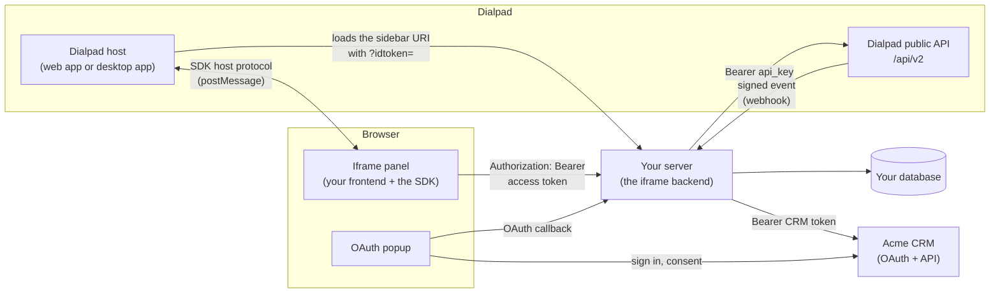

What a production server keeps in its database:

| What                                                  | Keyed by                    | Used for                                                                                                     |
| ----------------------------------------------------- | --------------------------- | ------------------------------------------------------------------------------------------------------------ |
| The Dialpad user's `api_key` (encrypted at rest)      | Dialpad company and user id | Calling Dialpad's API at any time ([flow 6](#6-server-to-server-calling-dialpads-api))                       |
| Sessions: a hash of the access token, user, expiry    | The access token's hash     | Authenticating the iframe panel's requests ([flow 2](#2-authenticating-every-request-from-the-iframe-panel)) |
| OAuth `state` records: user, PKCE verifier, expiry    | The random `state`          | Finishing a Connect ([flow 3](#3-external-oauth-connect))                                                    |
| CRM tokens (access and refresh, encrypted at rest)    | Dialpad company and user id | "Connected" means these exist; every CRM call ([flows 3 to 5](#3-external-oauth-connect))                    |
| Contact mappings: Dialpad contact id to CRM record id | Dialpad company and user id | Contact pulling ([flow 5](#5-external-contact-pulling))                                                      |
| Webhook id and its signing secret (encrypted)         | Your own id for the webhook | Verifying incoming events ([flow 7](#7-event-subscriptions-and-webhooks))                                    |

---

## 1. Initial iframe page load

Dialpad opens the OAuth app's conversation sidebar URI in an iframe and appends
`?idtoken=<token>`. This is the only request authenticated by the idtoken. It
identifies the user, hands your server the user's `api_key`, and starts the
session that every later request uses.

### On the server

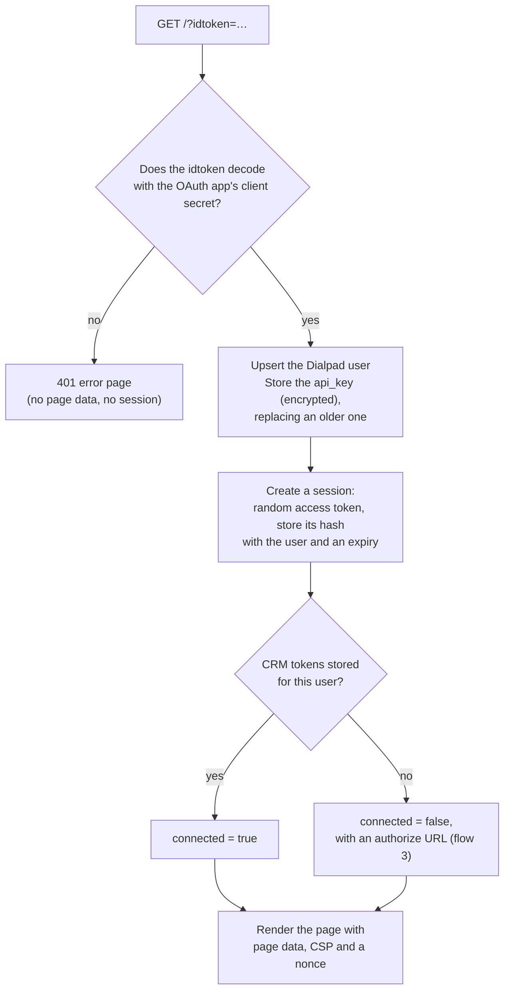

The page data holds only what the iframe panel needs: the Dialpad origin, the API
prefix, the **access token**, and the `external_connection` (connected or not, an
authorize URL per OAuth client, the scopes). The idtoken's profile and the
`api_key` never go to the browser.

The idtoken travels in a URL and does not expire, so treat that URL as a secret:
serve the page with `Referrer-Policy: no-referrer` and `Cache-Control: no-store`,
and keep query strings out of your access logs and error reports.

### From Dialpad to a working panel

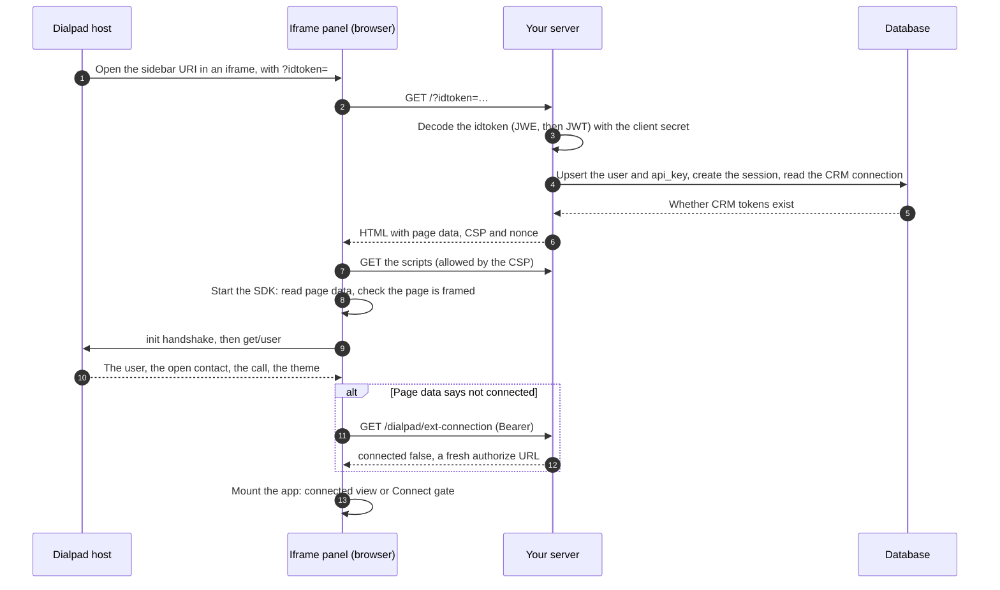

What the browser does:

1. The SDK starts, reads the page data, and refuses to run unless the page is
   inside an iframe. It then talks only to the page data's `dialpad_origin`.
2. If the SDK refuses to start (`bad_options`, `not_framed`, `bad_page_data`,
   `init_timeout`) the page is not in a working Dialpad iframe: show "Open this
   panel from Dialpad" and nothing else.
3. Otherwise apply Dialpad's theme, give your HTTP wrapper the SDK's
   `authHeaders()`, and mount the app. It shows the connected view when the SDK's
   `connection.connected` is true and the Connect gate otherwise.

Every page load is a new session. Old sessions expire, or you delete them; the
`api_key` and the CRM connection are not tied to any one session.

---

## 2. Authenticating every request from the iframe panel

The iframe has no idtoken, so every request it makes after the page load proves
itself with the access token the page handed out, in an `Authorization: Bearer`
header. This covers the two requests the SDK makes itself (`ext-connection` and
`ext-disconnect`, the only ones it invokes) and every route your application adds,
such as `/api/contact`.

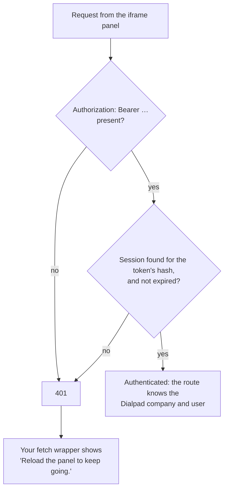

- **Browser side.** One `api()` wrapper around `fetch` adds the SDK's
  `authHeaders()` to every request and, on a `401`, shows the reload notice. Pass
  it to the SDK as its `fetch` so the SDK's own calls go through it too; your
  routes use it the same way.
- **Server side.** One authentication step (a middleware or dependency) turns the
  bearer token into the session's user. A route learns who is asking from it,
  never from the idtoken or from anything in the request body.
- **Why a header and no cookie.** A browser attaches cookies to requests another
  site makes (the panel is in a third-party iframe, so a cookie would need
  `SameSite=None` and `Partitioned`, and some browsers refuse such cookies). It
  never attaches an `Authorization` header on its own, so a request from another
  site cannot carry it, and there is no cross-site request forgery to defend
  against. Keep the token in memory (a variable), not in `localStorage`, and
  protect the page from script injection with the CSP in
  [flow 8](#8-other-behaviour-of-the-iframe-panel). Don't enable cross-origin
  access (CORS) on these routes: the panel is served by the same server.
- **Revoking.** Delete the session row and the next request gets `401`. Expiry
  does the same.
- **Alternatives.** A short-lived signed token (a JWT) works as well as a session
  table if you prefer no lookup; you give up early revocation. The contract only
  needs _some_ token the panel can send.

---

## 3. External OAuth (Connect)

The user connects their Acme account to Dialpad's panel. Dialpad opens your
authorize URL in a popup (web app) or a login window (desktop app), the user signs
in and consents at the CRM, and your server ends up holding the CRM's tokens for
that Dialpad user.

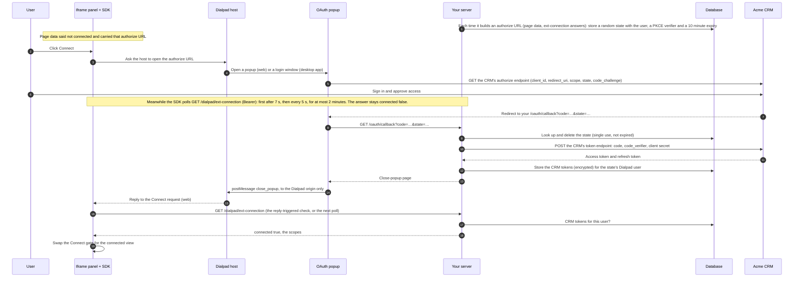

Points to get right:

- **The `state`** is a random, single-use value you store with the Dialpad user it
  was created for. The callback learns who is connecting only from it, so a
  callback can never connect someone else, and a replayed or expired one is
  rejected. Use PKCE as well when the CRM supports it.
- **"Connected" is a fact in your database**: the CRM tokens exist. So
  `ext-connection` answers the same on any server instance, after any restart, in
  any browser, and a connection completed late (after the SDK stopped polling) shows
  up at the next check or page load. There is nothing to hand from the popup to
  the panel, because both read the same row.
- **The popup talks only to Dialpad.** The close-popup page calls
  `window.opener.postMessage('close_popup', <Dialpad origin>)`, never `'*'`.
- **Tokens stay on the server.** Never put CRM tokens in the page, a response or a
  log. Refresh them with the refresh token when they expire (flow 5).

### When it goes wrong

| What happens                                              | Result                                                                                              |
| --------------------------------------------------------- | --------------------------------------------------------------------------------------------------- |
| The user denies access at the CRM (`error=access_denied`) | The callback shows a short "not connected" page and closes the popup; nothing is stored             |
| The `state` is unknown, used before or expired            | The callback shows an error page; nothing is stored                                                 |
| The code exchange fails                                   | The callback shows an error page; nothing is stored                                                 |
| The user never finishes                                   | The SDK gives up after 2 minutes; the gate says Acme didn't respond, with **Try again**             |
| The connection check fails (network, non-`2xx`)           | The gate shows the matching message (`network`, `request_failed`) with **Try again**                |
| The access token is rejected (`401`)                      | "Reload the panel to keep going." ([flow 2](#2-authenticating-every-request-from-the-iframe-panel)) |

---

## 4. External disconnect

The user ends the connection, from a **Disconnect** button in your panel or from
Dialpad's own panel menu. Both take the same path inside the SDK (the menu skips
your confirmation).

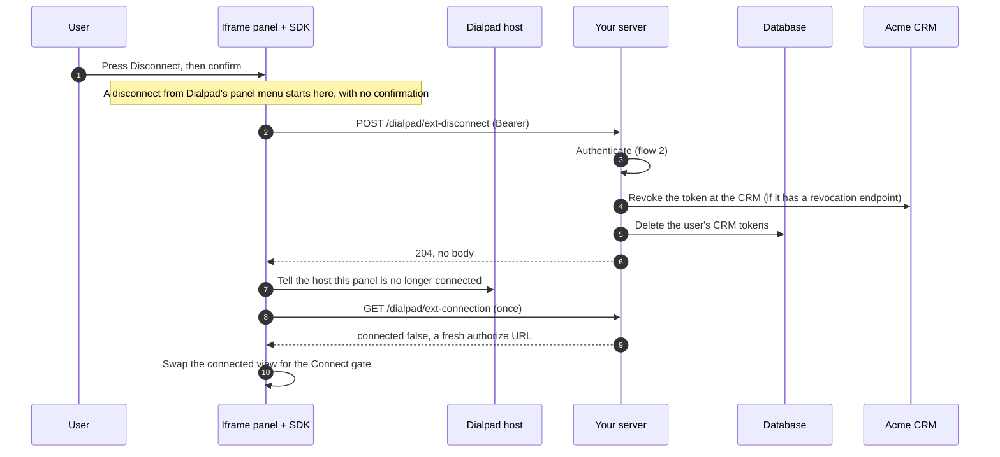

- **The session survives.** Only the CRM tokens go, so the SDK's follow-up
  `ext-connection` still authenticates.
- **It disconnects everywhere.** The connection is the user's CRM tokens, not a
  browser's state: other open panels of the same user find out at their next call
  (a `403 not_connected` from a CRM route, or the next `ext-connection`) and should
  offer to reconnect.
- **If the call fails** the user stays connected and sees an error next to the
  button.
- **Keep or delete the rest.** Deleting the contact mappings is optional; keeping
  them makes a reconnect instant. Follow your data-retention rules.
- **The CRM can disconnect the user too.** When a CRM call fails with an
  invalid-grant error (the user revoked access, or the refresh token expired),
  delete the tokens and answer `not_connected` from then on.

---

## 5. External contact pulling

Dialpad tells the iframe panel which contact is open, but that is **Dialpad's**
contact: a name, phones and emails from Dialpad's directory. What a partner's panel
exists to show is the partner's own record for that person. Getting from one to the
other is the **contact mapping**, and it happens on the server because it needs the
user's CRM credentials.

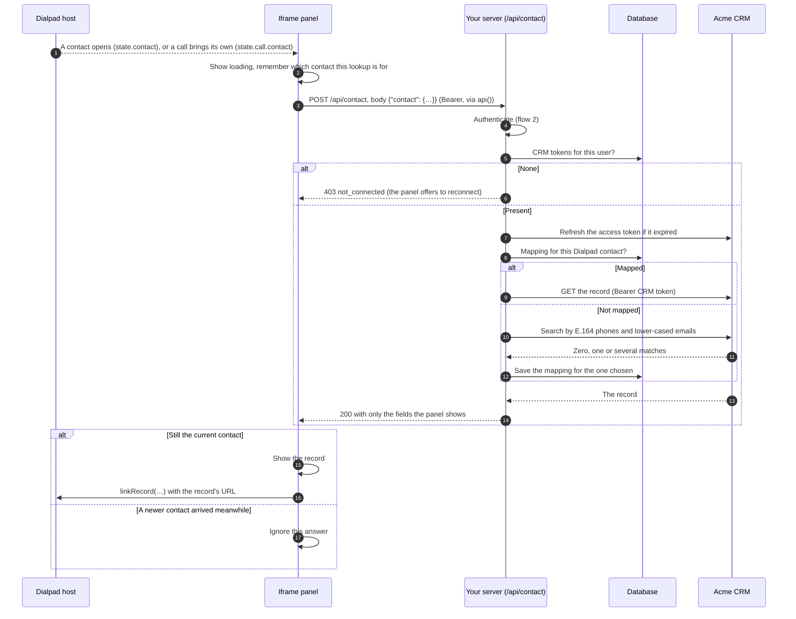

The route, after authenticating the request:

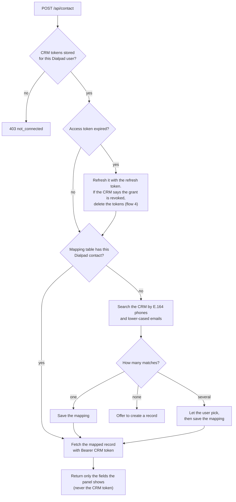

1. **Check the connection and get the CRM token.** None means not connected
   (`403`). Refresh an expired token with the stored refresh token, and delete the
   tokens if the CRM says the grant was revoked.
2. **Map the Dialpad contact to a CRM record.** Look in your mapping table
   (Dialpad contact id to CRM record id) first. Otherwise search the CRM by the
   contact's phone numbers and emails, normalised to the form the CRM stores, and
   decide what zero, one and several matches mean. Save the choice.
3. **Fetch the mapped record** with `Authorization: Bearer <CRM access token>` and
   return only the fields the panel shows, in your own response shape.
4. **Tell Dialpad about the match.** When the panel has the record it calls the
   SDK's `linkRecord(...)`, so Dialpad can offer "View record" in the panel menu and
   use the record's URL for screen pops when a call comes in.
5. **Handle the CRM being slow or down** with a short timeout and an error the
   panel can show.

**Panel contact and call contact.** During a call there can be two contacts: the
panel's (`state.contact`) and the call's own (`state.call.contact`). Usually they
are the same person and one section is enough; when they differ, look up and show
both. Ignore an answer for a contact that is no longer the open one.

---

## 6. Server to server: calling Dialpad's API

Your server calls Dialpad's public API (`https://dialpad.com/api/v2/…`, or
`https://dialpadbeta.com/api/v2/…` for beta) with the user's `api_key`. The browser
never has the key and never calls Dialpad's API directly: what the panel needs from
Dialpad (the user, the open contact, the call) arrives through the SDK's host
protocol, which needs no key because Dialpad itself framed the page.

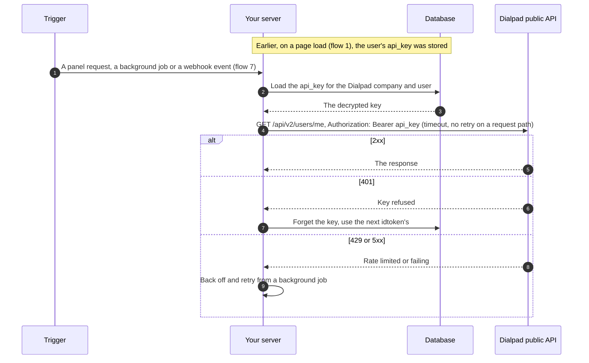

- **Where the key comes from.** The idtoken carries it on every page load. The key
  never expires, so store it the first time you see it for a Dialpad user
  (encrypted at rest, never logged) and replace it whenever a newer idtoken carries
  a different one. The idtoken only arrives while a user has the panel open; the
  stored key is what lets you call Dialpad from a background job, a webhook handler
  or after the panel is closed.
- **How to send it.** `Authorization: Bearer <api_key>` on every request. Dialpad's
  own client libraries add the header for you (for Python,
  [`python-dialpad`](https://pypi.org/project/python-dialpad/)).
- **Whose key.** It is scoped to that user and your app. Some endpoints need more
  than a user's key: listing and creating event subscriptions needs a company admin
  API key, for example, so check each endpoint's reference page.
- **Latency and limits.** Each endpoint documents a rate limit (for example 100 per
  minute for creating a webhook, 1200 per minute for listing them). On a request
  path use a short timeout and no retry; retry with backoff from a background job.
  Treat a `401` as "this key was refused".

---

## 7. Event subscriptions and webhooks

Instead of polling, your server can ask Dialpad to push events (calls, SMS,
contacts, agent status, change logs) to a URL on your server. Dialpad then calls
you, so **you** have to prove the request came from Dialpad. See Dialpad's
[Event Subscriptions](https://developers.dialpad.com/docs/event-subscriptions) guide.

### Setting it up (once)

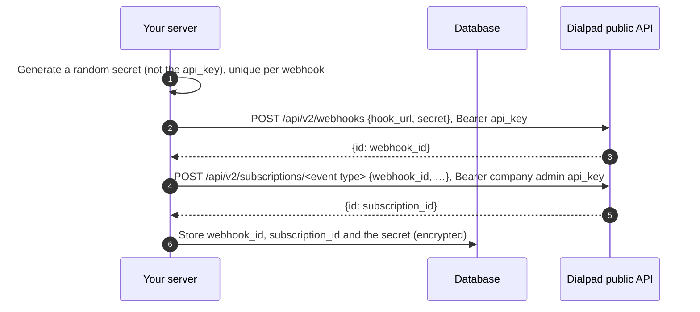

- **A webhook** is a URL plus a secret; one webhook can serve several
  subscriptions. A **subscription** says which events (one call, SMS, contact or
  agent-status stream, optionally filtered) go to which webhook. Creating them needs
  an API key allowed to ([Webhook Create](https://developers.dialpad.com/reference/webhookscreate),
  [Subscriptions](https://developers.dialpad.com/reference/subscriptions)).
- **The secret is yours.** You generate a secure random string and give it to
  Dialpad when you create the webhook. It is different from your `api_key`.
  Dialpad recommends a unique secret per subscription so that a leak has a small
  blast radius.
- **Always provide a secret.** Without one Dialpad sends plain, unsigned JSON, and
  anyone who finds your URL can forge events.
- **Make the URL tell you which secret.** Give each webhook its own path, such as
  `/webhooks/dialpad/<your-webhook-id>`, so the server can load the right secret
  before it has read anything it doesn't trust yet.
- Subscriptions have limits per type and company (see the guide).

### When an event occurs

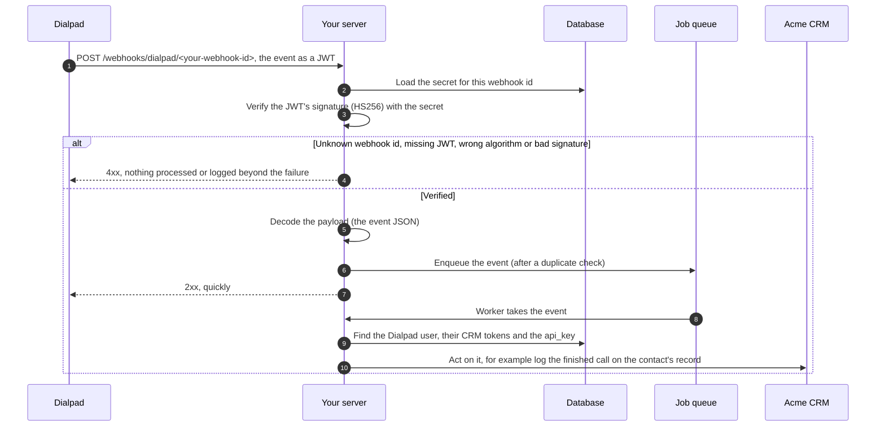

**How to validate the incoming request**, in this order:

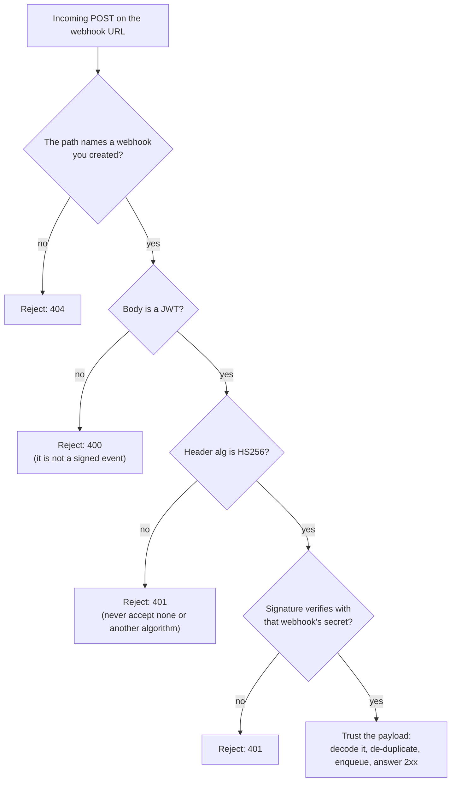

1. **Pick the secret from the URL, not from the token.** Never read a key id or
   secret from inside the unverified JWT.
2. **Pin the algorithm to HS256** and verify the signature with the webhook's
   secret before looking at any claim or payload. Use a JWT library's verify call
   (for example `jwt.decode(token, secret, algorithms=["HS256"])`), not a manual
   decode.
3. **Only after the signature is valid** treat the payload as data from Dialpad.
   Validate its shape before using it, as with any input.
4. **De-duplicate.** Make processing safe to repeat, so a repeated delivery does
   no harm: key it on the event's identity (for a call event, its call id and
   state).
5. **Answer fast, work later.** Return a `2xx` once the event is queued, and do the
   CRM work in a worker. Don't make Dialpad wait on the CRM.
6. **Don't log the body or the secret.** Log the webhook id and the outcome.
7. **Rotate by replacing.** To change a secret, create a new webhook with a new
   secret, point the subscriptions at it, then delete the old one.

---

## 8. Other behaviour of the iframe panel

| Behaviour                        | What happens                                                                                                                                                                                                                   |
| -------------------------------- | ------------------------------------------------------------------------------------------------------------------------------------------------------------------------------------------------------------------------------ |
| **Host events after start**      | The SDK keeps its `state` current from Dialpad's events: the open contact, the call (ringing, connected, ended, a new call) and the light or dark theme. Render from `state`; follow the theme. Connecting does not reset them |
| **Opened outside Dialpad**       | The SDK's `not_framed` check fails: show "Open this panel from Dialpad" and run nothing else (flow 1)                                                                                                                          |
| **A bad idtoken**                | A `401` error page with no page data and no session (flow 1)                                                                                                                                                                   |
| **The access token is rejected** | "Reload the panel to keep going." A reload loads the page again and gets a new session (flow 2)                                                                                                                                |

**Framing, CSP and nonces.** Every page your server renders carries a
`Content-Security-Policy`:

| Page                              | Policy                                                                                                   |
| --------------------------------- | -------------------------------------------------------------------------------------------------------- |
| The iframe panel, `GET /`         | `frame-ancestors <Dialpad origin>; script-src 'self' 'nonce-…'; object-src 'none'; base-uri 'none'`      |
| Close-popup page (OAuth callback) | `default-src 'none'; script-src 'nonce-…'; style-src 'nonce-…'; frame-ancestors 'none'; base-uri 'none'` |
| Error pages                       | `default-src 'none'; style-src 'nonce-…'; frame-ancestors <Dialpad origin>; base-uri 'none'`             |

- `frame-ancestors` lets only Dialpad embed the panel, which stops other sites from
  framing it (clickjacking). The popup pages cannot be framed.
- `script-src 'self' 'nonce-…'`, with no `'unsafe-inline'` or `'unsafe-eval'`, means
  only your own script files run: an injected inline script does not. This is what
  protects the access token held in memory ([flow 2](#2-authenticating-every-request-from-the-iframe-panel)).
- The **nonce** is a fresh random value for each response, written into the header
  and onto the inline elements you allow. Never reuse one.
- Add `Referrer-Policy: no-referrer`, `Cache-Control: no-store` and
  `X-Content-Type-Options: nosniff`, escape every value you put into HTML, and
  validate the Dialpad origin before it reaches a header or a script.
