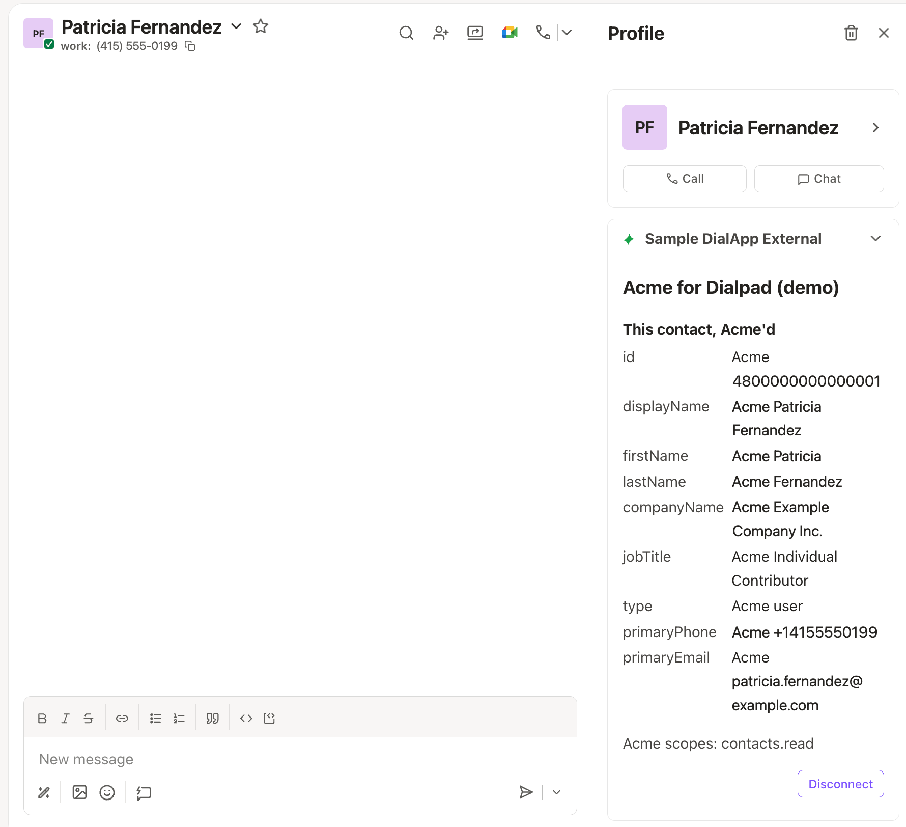
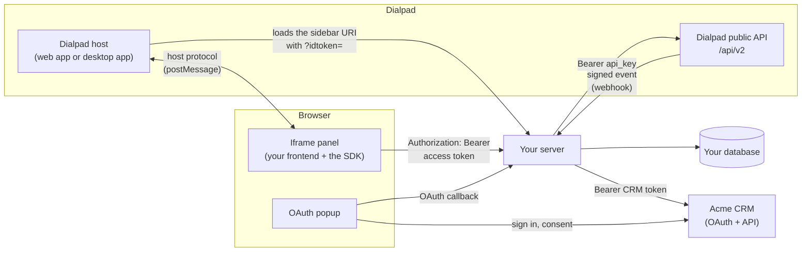

# 1. The big picture

A rightbar app is a web page that Dialpad shows in a panel beside a contact or a
call. It shows the user what your system knows about that person, usually their
record in a CRM. It can also serve other integrations, such as one that shows a
call's AI transcript or summary from Dialpad's call events
([chapter 8](08-call-dialpad.md#receive-dialpads-events)). This guide uses a CRM
as its example. This chapter gives you the whole picture; the chapters after it
build each part.

## The pieces

| Piece                | What it does                                                                                                                                     |
| -------------------- | ------------------------------------------------------------------------------------------------------------------------------------------------ |
| Dialpad host         | The Dialpad web app or desktop app. It frames your page, tells it which contact and call are open, and shows your toasts, header button and menu |
| The iframe panel     | Your frontend, running in an iframe inside Dialpad                                                                                               |
| The SDK              | `@dialpad/dialapp-external-sdk`, inside your panel. It does everything on the Dialpad side, so your code never deals with Dialpad's protocol     |
| Your server          | Serves the panel page, checks every request from the panel, and calls the CRM and Dialpad's API. Any language works                              |
| Your database        | Holds access tokens, the user's CRM tokens, their Dialpad API key, and which CRM record matches which Dialpad contact                            |
| Your service         | Your system, with its own OAuth and API. Here, the fictional Acme CRM                                                                            |
| Dialpad's public API | What your server calls, with the user's Dialpad API key                                                                                          |

## The life of a panel

1. **Dialpad loads your page.** It opens your app's sidebar URI in an iframe and
   adds `?idtoken=…`, a token that says who the user is and carries their Dialpad
   API key. See [chapter 3](03-load-the-panel-page.md).
2. **Your server returns the panel page.** It decodes the idtoken, hands out
   an access token, and puts it and the user's CRM connection status in the
   page ([chapter 3](03-load-the-panel-page.md)).
3. **The SDK starts.** It checks that Dialpad frames the page, completes a
   handshake with Dialpad, and loads the user, the open contact, the call, and the
   theme. Your panel renders from that ([chapter 4](04-build-the-panel.md)).
4. **The panel calls your server**, sending the access token with every request
   ([chapter 5](05-authenticate-requests.md)).
5. **The user connects their account in your service** by signing in through an
   OAuth popup. Your server stores the service's tokens
   ([chapter 6](06-connect-to-the-crm.md)).
6. **In a CRM app, the panel shows the CRM record** of each contact the user
   opens. Your server finds the matching record, and the panel tells Dialpad
   about it ([chapter 7](07-show-the-crm-record.md)).
7. **Your server calls Dialpad** with the stored API key, and receives Dialpad's
   events, whenever it needs to, even with no panel open
   ([chapter 8](08-call-dialpad.md)).
8. **The user disconnects**, from your panel or from Dialpad's panel menu, and
   your server deletes the CRM tokens ([chapter 6](06-connect-to-the-crm.md)).

## Key terms

| Term          | Meaning                                                                                                                                       |
| ------------- | --------------------------------------------------------------------------------------------------------------------------------------------- |
| Your service  | The system the user connects to through OAuth. The guide's example is a CRM, so read "CRM" and "CRM tokens" as your service and its tokens    |
| Sidebar URI   | The URL Dialpad loads in the panel: your OAuth app's _conversation sidebar URI_, which Dialpad sets up for you                                |
| idtoken       | The encrypted, signed token Dialpad adds to the sidebar URI. Only your server can decode it, with your OAuth app's client secret              |
| API key       | The `api_key` inside the idtoken: your server's credential for Dialpad's public API, for this user and your app                               |
| Page data     | A JSON element your server puts in the page for the SDK: Dialpad's origin, the access token, and the connection status                        |
| Access token  | A random token your server creates on each page load. The panel sends it as `Authorization: Bearer` on every request                          |
| Connection    | Whether the user has connected their account in your service, and the URLs that connect it. The page data calls it `external_connection`      |
| Connect       | The OAuth flow that links the Dialpad user to their account in your service                                                                   |
| Host protocol | The `postMessage` messages between the panel and Dialpad. The SDK speaks it for you                                                           |
| The contract  | The endpoints and data your server provides for the SDK and Dialpad, described in [`contract/openapi.json`](../contract/openapi.json) (below) |

## Which chapters you need

| You're building                                                               | Read                                                                        |
| ----------------------------------------------------------------------------- | --------------------------------------------------------------------------- |
| A panel that shows the open contact's CRM record                              | Chapters 1 to 11                                                            |
| Another integration, such as one that shows a call's AI transcript or summary | Chapters 1 to 6, then 8 to 11. Skip chapter 7. Chapter 8 covers call events |

For a panel that isn't Vue, also read [chapter 12](12-plain-javascript.md) or
[chapter 13](13-react.md).

## The four secrets

Four different secrets appear in this guide. They aren't interchangeable.

| Secret                                                | Who issues it                               | What it's for                                                                  |
| ----------------------------------------------------- | ------------------------------------------- | ------------------------------------------------------------------------------ |
| **OAuth app client secret** (`DIALPAD_CLIENT_SECRET`) | Dialpad, when it sets up your OAuth app     | Decoding the idtoken on the page request, and nothing else                     |
| **API key** (`api_key`, inside the idtoken)           | Dialpad, per user and app                   | `Authorization: Bearer` on your server's calls to Dialpad's public API         |
| **Access token** (in the page data)                   | Your server, per page load                  | `Authorization: Bearer` on every request the panel makes to your server        |
| **Webhook signing secret**                            | You, when you create a webhook with Dialpad | Checking that the events Dialpad sends to your server really came from Dialpad |

## What your server stores

| What                                                             | Keyed by                    | Used for                                                                              |
| ---------------------------------------------------------------- | --------------------------- | ------------------------------------------------------------------------------------- |
| The user's API key (encrypted)                                   | Dialpad company and user ID | Calling Dialpad's API at any time ([chapter 8](08-call-dialpad.md))                   |
| Access tokens: a hash of each, the user, an expiry               | The access token's hash     | Checking the panel's requests ([chapter 5](05-authenticate-requests.md))              |
| OAuth `state` records: user, PKCE verifier, expiry               | The random `state`          | Finishing a Connect ([chapter 6](06-connect-to-the-crm.md))                           |
| CRM tokens, access and refresh (encrypted)                       | Dialpad company and user ID | "Connected" means these exist; every CRM call ([chapter 6](06-connect-to-the-crm.md)) |
| Contact mappings (CRM apps): Dialpad contact ID to CRM record ID | Dialpad company and user ID | Finding the CRM record of a contact ([chapter 7](07-show-the-crm-record.md))          |
| Webhook ID and its signing secret (encrypted)                    | Your own ID for the webhook | Checking incoming events ([chapter 8](08-call-dialpad.md#receive-dialpads-events))    |

## The contract

Your server can be in any language. The SDK and Dialpad need these four
operations from it:

| Operation                      | Authenticated by        | Answers                                                                                                          |
| ------------------------------ | ----------------------- | ---------------------------------------------------------------------------------------------------------------- |
| `GET /`                        | `?idtoken=…`            | The panel page, at your sidebar URI. `401` when the idtoken doesn't decode; `403` when your app refuses the user |
| `GET /dialpad/ext-connection`  | The bearer access token | `200` with the user's connection to the CRM. `401` when the token is rejected                                    |
| `POST /dialpad/ext-disconnect` | The bearer access token | `204` with no body (a `200` with the connection works too) after disconnecting the user. `401` as above          |
| `GET /oauth/callback`          | Your own OAuth `state`  | `200` with the close-popup page, after storing the CRM tokens. The path is your choice                           |

[`contract/openapi.json`](../contract/openapi.json) describes them as OpenAPI 3.1,
with their schemas: `IdTokenClaims` (the decoded idtoken), `PageData`,
`ExternalConnection` (the connection), and `ErrorResponse`. The SDK always calls
the two `/dialpad` endpoints at those paths. Your own routes, such as this app's
`POST /api/contact`, sit beside them and aren't part of the contract.

The file is generated, so don't edit it by hand. Its `info.version` is the SDK
version it describes.

## This repository

This repository is a working rightbar app, "Acme for Dialpad", for the fictional
Acme CRM. Its panel shows the Dialpad user, the call, the OAuth scopes, and the
open contact with every text field prefixed `Acme `, which proves the data went
to the server and back.

- **The panel** (`client/`) uses Vue 3 and Dialtone 10, Dialpad's design system.
  Any framework works; [chapter 12](12-plain-javascript.md) and
  [chapter 13](13-react.md) show the panel without Vue.
- **The server** (`server/`) is Python and Sanic. It's a reference, not a
  requirement. Its contract code is in `dialpad/` (the idtoken, the page data,
  the panel page, and the `/dialpad` routes) and Connect's OAuth round trip is
  in `connect/`; port those and `pages.py` (the security headers) to your
  language and keep the rest of your server.
- **The demo has no database and no real CRM**, so it takes some shortcuts. Each
  chapter ends with what the demo does differently, and
  [chapter 11](11-from-demo-to-your-app.md) lists what to replace.

---

**Next:** [2. Run the demo](02-run-the-demo.md) · [Contents](../README.md#the-guide)
