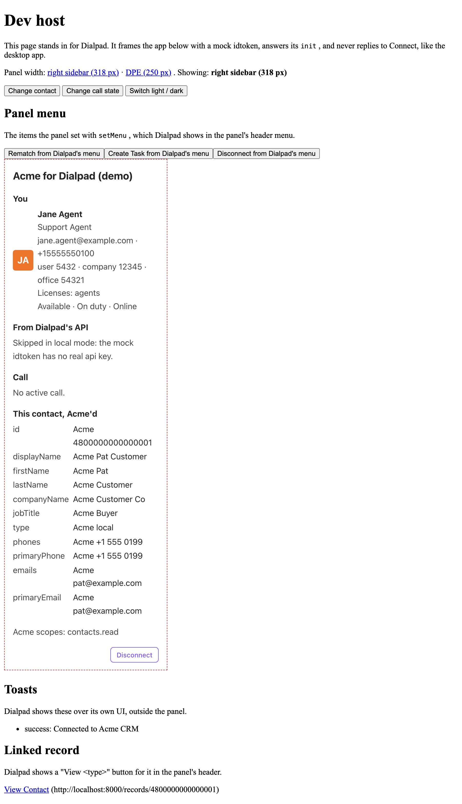

# 2. Run the demo

Run the app on your machine, with a page that stands in for Dialpad, then inside
Dialpad itself.

## Install

You need Node 24, Corepack (for pnpm 12), and Python 3.14. To run the server's
checks with tox, you also need [uv](https://docs.astral.sh/uv/).

```sh
nvm use                                  # reads .nvmrc (24)
corepack enable
cd client && pnpm install

cd ../server
python3.14 -m venv .venv
.venv/bin/pip install -r requirements.txt --group dev
```

The client installs the SDK from a tarball in `client/vendor/`, the same way you
install the one Dialpad sends you: `client/package.json` points at
`vendor/dialpad-dialapp-external-sdk-<version>.tgz`. Nothing needs Dialpad's
private registry. The server installs only public packages: `requirements.txt`
has what it runs on, and the `dev` dependency group in `server/pyproject.toml`
adds the test, lint, type-check, and style tools.

### Upgrade the SDK

Dialpad sends each SDK build as a `dialpad-dialapp-external-sdk-<version>.tgz`
file. To move to a new one, from `client/`:

1. Replace the old tarball in `vendor/` with the new one.
2. Install it:

   ```sh
   pnpm add ./vendor/dialpad-dialapp-external-sdk-<version>.tgz
   ```

   This updates `pnpm-lock.yaml` and the `file:vendor/...` dependency in
   `package.json`.

3. Run the client's checks: `pnpm types:check && pnpm test:run`, and
   `pnpm test:e2e` if you keep the browser tests.

The [contract](01-the-big-picture.md#the-contract) isn't in the tarball:
`contract/openapi.json` is a copy, and its `info.version` names the SDK version
it describes. Check that it still matches. The server has nothing to update,
because it uses no Dialpad library.

`client/scripts/vendor.mjs` (the `pnpm run vendor` script) is Dialpad's own
tooling for testing a freshly built tarball. Delete it if you like, together with the
`vendor` script in `client/package.json`.

## Run it locally

_Local mode_ runs everything on `http://localhost`, with a _dev host_ page that
stands in for Dialpad. In two terminals:

```sh
cd server && LOCAL_MODE=1 .venv/bin/python -m acme_dialpad_rightbar   # http://localhost:8000
cd client && pnpm dev                                                  # http://localhost:5173
```

Open <http://localhost:5173/dev-host/>. The dev host (`client/dev-host/`) asks the
server for a page URL with a mock idtoken, frames the panel, and gives you
buttons to:

- Change the open contact (it cycles through three).
- Change the call: ringing, connected, ended, and a new call ringing.
- Switch between light and dark.
- Pick an item in the panel menu the panel set, the way Dialpad's panel menu
  does. Once you've connected, it holds **Rematch** and **Create Task**, which
  the demo answers with a toast saying they aren't implemented, and
  **Disconnect**.

The links at the top show the panel at 318 pixels, the right sidebar's default
width, or at 250 pixels, the width of Dialpad Everywhere. Under the panel, the
dev host lists the toasts the panel asked for, which Dialpad shows outside the
panel, and the record the panel linked, which Dialpad shows as a **View
Contact** button in the panel's header.



### Try Connect

1. Click **Connect**. A popup opens the demo's fake authorize page, and the panel
   shows "Waiting for you to finish connecting".
2. Click **Authorize** in the popup. The popup goes to the callback and closes.
3. The panel finds out on its next check, after 7 seconds and then every 5
   seconds. It then shows you and the open contact, with its fields prefixed
   `Acme `.
4. Click **Disconnect** and confirm.

The dev host never answers the Connect request, like the desktop app, so the
SDK's polling is what finishes Connect here.

### What local mode changes

`LOCAL_MODE=1` fills in every setting a local run needs, including a test client
secret that the dev host also uses for its mock idtoken. It changes the page's
`Content-Security-Policy` in three places: `frame-ancestors` is the dev host's
origin, `script-src` adds the Vite dev server, and `connect-src` adds its
websocket. It also adds the `/dev/frame-url` route that mints the mock idtoken.
It's configuration only; no request can turn it on.

Browsers treat `localhost` as a secure context, so the app's `Secure` cookie
works in Chrome and Firefox. Safari may not treat `localhost` as secure for
cookies; for Safari, use a trusted local certificate such as `mkcert`.

## Run it in Dialpad

You need an OAuth app that Dialpad sets up for you.

1. Build the panel (`pnpm build` in `client/`), and run the server from `server/`
   without `LOCAL_MODE`, with the four required settings:

   ```sh
   cd server && DIALPAD_CLIENT_SECRET=... DIALPAD_ORIGIN=https://dialpad.com \
     APP_SECRET=... BASE_URL=https://your-public-url .venv/bin/python -m acme_dialpad_rightbar
   ```

2. Make the server reachable at that public HTTPS URL.
3. Ask Dialpad to set your OAuth app's conversation sidebar URI to it.
4. Enable the app in Dialpad's admin settings.
5. Open a contact in Dialpad. The panel appears, and Connect and Disconnect work
   against the real Dialpad.

The demo works in the Dialpad desktop app and the latest versions of Chrome,
Edge, Firefox, and Safari. The SDK itself supports Chrome 109 and later and the
Dialpad desktop app.

[`deployment/README.md`](../deployment/README.md) shows how to run the app as a
container on Google Cloud Run. The
[reference](reference.md#the-servers-environment-variables) lists every
environment variable the server reads.

## In this demo

The fake authorize page, the `Acme ` prefix, and the dev host exist only for the
demo. [Chapter 11](11-from-demo-to-your-app.md) lists what to replace.

---

**Previous:** [1. The big picture](01-the-big-picture.md) ·
**Next:** [3. Load the panel page](03-load-the-panel-page.md) ·
[Contents](../README.md#the-guide)
