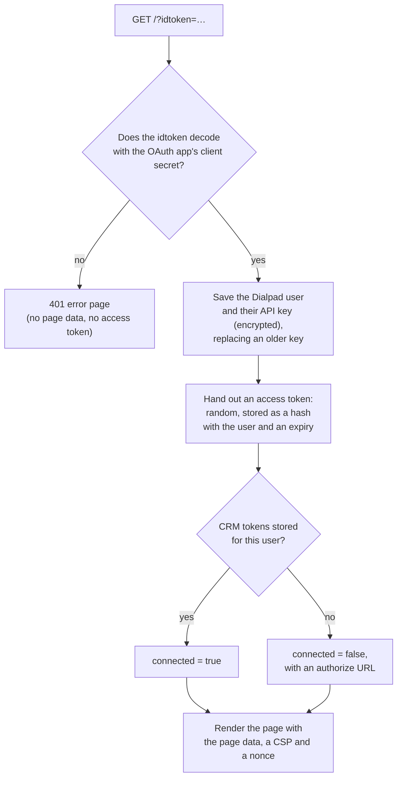
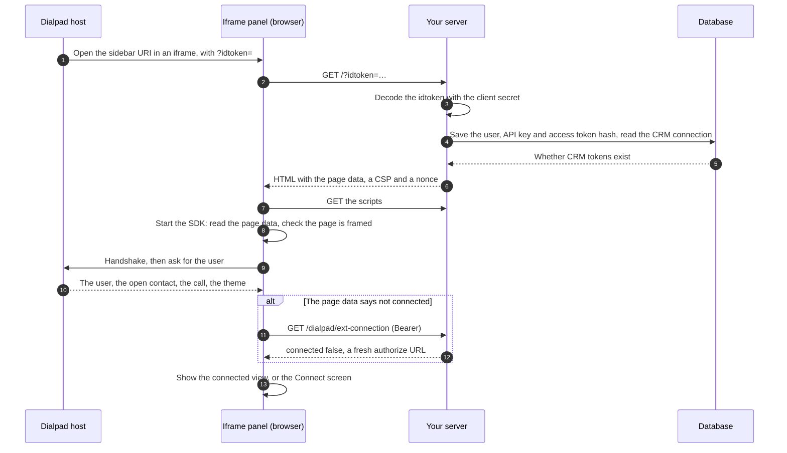

# 3. Load the panel page

Every panel starts with one request: Dialpad loads your sidebar URI with
`?idtoken=<token>` added. Your server decodes the token, hands out an access
token, and returns the page. This is the only request the idtoken authenticates.

## The flow

On the server:



From Dialpad to a working panel:



## Decode the idtoken

The idtoken is a JWT inside a JWE:

- **The outer layer** is a compact JWE using `dir` and `A192CBC-HS384`. Its key is
  the first 48 characters of your OAuth app's client secret.
- **Inside** is a JWT signed with `HS256` and the full client secret.
- **Its claims** are the Dialpad `user_id`, `company_id`, and `office_id`; the
  user's `name`, `email`, `phone_number`, and `image_url`; an internal `csr`
  claim; and the `api_key`.

Any JOSE library can decode it. To decode one:

1. Read the `idtoken` query parameter. If it's missing or empty, answer `401`.
2. Decrypt the JWE. Use the first 48 characters of the client secret, as UTF-8
   bytes, as the key itself: `dir` means no key wrapping, hashing, or derivation.
   Accept only `alg: dir` and `enc: A192CBC-HS384`. Dialpad's client secrets are 50
   characters long, so a shorter secret is a configuration error, not a bad token.
3. Verify the JWT's signature with the full client secret, as UTF-8 bytes,
   accepting only `HS256`.
4. Read the claims. `user_id`, `company_id`, `office_id`, and `api_key` are
   required; the profile claims can be missing. Drop `csr`, and ignore claims you
   don't know, because Dialpad may add more. The token has no `exp` claim, so
   don't make your JWT library require one.
5. Treat a failure at any step the same way: answer `401` with an error page,
   render no page data, and don't log the token.

To test a decoder in another language, use the tokens in
`server/tests/vectors/dialpad_idtokens.json`. They're built the way Dialpad
builds them, with a test client secret that's in the same file, and each lists the claims it must
decode to.

The idtoken never expires and travels in a URL, so treat the URL as a secret.
Serve the page with `Referrer-Policy: no-referrer` and `Cache-Control: no-store`,
and keep query strings out of your access logs and error reports.

## Keep the API key

The idtoken's `api_key` is a credential for Dialpad's public API, for this user
and your app. It never expires. Store it in your database the first time you see
it for a Dialpad user: one row per user, keyed by Dialpad company ID and user ID,
with the key encrypted at rest. When a later idtoken carries a different key,
replace the stored one. Never send the key to the browser or log it.
[Chapter 8](08-call-dialpad.md) shows how to use it, and
[developers.dialpad.com](https://developers.dialpad.com/) documents what it can
call.

## Hand out an access token

The panel's later requests come from the iframe, which has no idtoken. So the
page request hands the panel an access token:

1. Create a random, opaque access token, such as 32 random bytes encoded as
   URL-safe base64.
2. Store it in your database, in whatever table suits your app, with:

   | What                         | Why                                                                                        |
   | ---------------------------- | ------------------------------------------------------------------------------------------ |
   | A hash of the access token   | To look the token up, such as by SHA-256                                                   |
   | The Dialpad company and user | Who the token belongs to                                                                   |
   | An expiry                    | When the token stops working. Choose a lifetime that covers a user's working day, at least |

   Store only the hash, so someone who reads your database can't use the tokens.

3. Put the token itself in the page data.

Every page load hands out a new token, so delete expired ones from time to time.
The API key and the CRM connection belong to the user, not to a token, so they
outlive it, and each lives in its own table. [Chapter 5](05-authenticate-requests.md) shows how the panel sends
the token and how your server checks it.

## Render the page

The page needs a mount element, your scripts, and the page data in a JSON
element that the SDK reads:

```html
<div id="app"></div>
<script type="application/json" id="dialpad-page-data" nonce="…">
  {"version": 1, "dialpad_origin": "https://dialpad.com", "access_token": "…", …}
</script>
```

| Page data field       | What it holds                                                                                                                 |
| --------------------- | ----------------------------------------------------------------------------------------------------------------------------- |
| `version`             | The page data format, `1`. The SDK checks it                                                                                  |
| `dialpad_origin`      | The Dialpad origin for this environment, such as `https://dialpad.com`. The SDK talks only to it                              |
| `access_token`        | The access token for this page load                                                                                           |
| `external_connection` | The user's CRM connection when the page rendered, so the first paint needs no request ([chapter 6](06-connect-to-the-crm.md)) |
| `app`                 | Optional JSON of your own for the panel, or `null` ([chapter 4](04-build-the-panel.md#pass-your-own-data-to-the-panel))       |

The page data holds no secrets beyond the access token. The API key and the
idtoken's profile claims never go into the page. Serve the page with a
`Content-Security-Policy` that lets only Dialpad frame it
([chapter 9](09-security-checklist.md#the-content-security-policy)).

### Escape the page data

Encoding the page data with plain `json.dumps` isn't safe. The browser ends the
`<script>` element at the first `</script>` in the text, even inside a JSON
string, so a contact name such as `</script><script>alert(1)</script>` closes the
element and injects a script. HTML escaping is wrong too: the browser doesn't
decode entities inside `<script>`, so the SDK reads `&lt;` as four
characters.

After encoding the JSON, replace these four characters everywhere in it:

| Character | Write it as |
| --------- | ----------- |
| `<`       | `\u003c`    |
| `>`       | `\u003e`    |
| `&`       | `\u0026`    |
| `'`       | `\u0027`    |

`JSON.parse` reads each escape back as the same character, so the SDK gets the
original values, but the text can no longer close the element, open an HTML
comment, or break out of an attribute. Libraries such as Jinja2's `tojson` filter
in Python and Gson's `new Gson().toJson(value)` on the JVM do this for you.

## Answer errors

When the idtoken doesn't decode, answer `401` with a small HTML error page. When
your app refuses the user, answer `403` the same way. Neither page has page data,
a script, or an access token.

## In this demo

- `server/acme_dialpad_rightbar/idtoken.py` decodes the idtoken (`decode_idtoken`).
  `pages.py` renders the page, the error page, and their security headers, and
  `endpoints/dialpad/page.py` is the route.
- The demo has no database. It keeps everything it must remember, the access
  token included, in one signed cookie instead
  (`server/acme_dialpad_rightbar/demo/fake_storage.py`), and it uses the API key
  once, for a demo call to Dialpad's API, then drops it
  ([chapter 11](11-from-demo-to-your-app.md#the-storage-cookie)).

---

**Previous:** [2. Run the demo](02-run-the-demo.md) ·
**Next:** [4. Build the panel with the SDK](04-build-the-panel.md) ·
[Contents](../README.md#the-guide)
