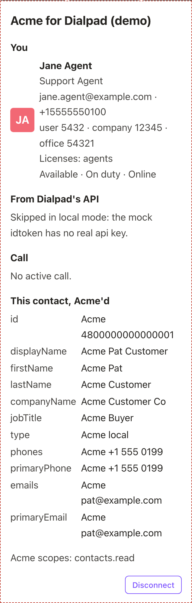
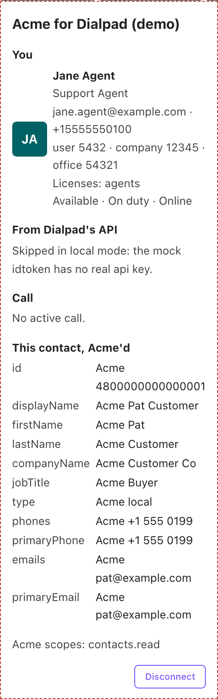
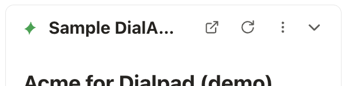

# 4. Build the panel with the SDK

`@dialpad/dialapp-external-sdk` connects your panel to Dialpad. It's headless: it
has no UI, so you build the panel with any framework, or none. It supports Chrome
109 and later and the Dialpad desktop app, and it's ES modules only, so use a
bundler such as Vite.

## Start the SDK

`createRightbar()` reads the page data, checks that Dialpad frames the page,
completes the handshake with Dialpad, and loads the call, the theme, the user,
and the open contact. Call it once, before your first render:

```ts
import { createRightbar, RightbarError } from "@dialpad/dialapp-external-sdk";
import { api } from "./api"; // your own fetch wrapper (chapter 5)

const root = document.getElementById("app")!;
try {
  const rightbar = await createRightbar({
    heightRoot: root,
    fetch: api,
    onDisconnect: () => {
      // clear any CRM data the panel holds
    },
  });
  // render your UI from rightbar.state
} catch (error) {
  if (!(error instanceof RightbarError)) throw error;
  root.textContent = "Open this panel from Dialpad.";
}
```

- **`heightRoot`** (required) is the element that holds the panel's content,
  usually your mount element. The SDK reports its height to Dialpad, which sizes
  the iframe to fit. Overlays placed under `body` take no space in it, so the SDK
  doesn't count them.
- **`fetch`** makes the SDK's own requests to your server. It defaults to the
  browser's `fetch`, and the SDK adds the `Authorization` header itself. Pass your
  own wrapper so you can notice a `401` ([chapter 5](05-authenticate-requests.md)).
- **`onDisconnect`** runs after the user disconnects
  ([chapter 6](06-connect-to-the-crm.md#disconnect)).

If the SDK can't start, `createRightbar()` rejects with a `RightbarError`. Its
`code` says why:

| Code            | Meaning                                                 |
| --------------- | ------------------------------------------------------- |
| `bad_options`   | `heightRoot` is missing, or a callback isn't a function |
| `not_framed`    | The page isn't open inside Dialpad                      |
| `bad_page_data` | The page data element is missing or invalid             |
| `init_timeout`  | Dialpad didn't answer the handshake within 10 seconds   |

In every case the panel can't work, so show a short "Open this panel from
Dialpad" message instead of the app, as the example does.

When the panel unmounts, call `rightbar.destroy()`. It stops listening to
Dialpad, stops any polling, and stops the height reports.

## Render from the state

`rightbar.state` is a snapshot of everything the panel knows:

```ts
rightbar.state;
// { ready, user, contact, call, theme: { mode, brand },
//   connection: { connected, pending, authorizationUrls, name, scopes, error } }
```

| Field        | What it holds                                                                                                                                                                                                                                                                                              |
| ------------ | ---------------------------------------------------------------------------------------------------------------------------------------------------------------------------------------------------------------------------------------------------------------------------------------------------------- |
| `ready`      | `true` once the handshake and the first loads are done, which is always the case after `createRightbar()` resolves                                                                                                                                                                                         |
| `user`       | The Dialpad user (IDs, names, emails, phone numbers, language, licenses, admin flags, and availability), or `null`. Dialpad sends no updates, so the fields are as of the panel's start. `language` is one of Dialpad's language codes, such as `en` or `ja` ([Translate the panel](#translate-the-panel)) |
| `contact`    | The contact open in Dialpad, or `null`. It changes when the user opens another contact, without reloading the panel ([chapter 7](07-show-the-crm-record.md#when-the-user-opens-another-contact)). The SDK also reloads it when the user presses Dialpad's refresh button or the contact's record changes   |
| `call`       | The active call, updated on every call event, or `null`                                                                                                                                                                                                                                                    |
| `theme`      | `{ mode: 'light' \| 'dark', brand }`. `brand` is `null` in this SDK version                                                                                                                                                                                                                                |
| `connection` | The user's connection to the CRM ([chapter 6](06-connect-to-the-crm.md#the-connection))                                                                                                                                                                                                                    |

Every change produces a new snapshot, and the parts that didn't change keep
their references. To follow changes:

- `rightbar.subscribe((next, prev) => …)` runs on every change.
- `rightbar.watch((state) => state.contact, (contact) => …)` runs its callback now
  and again whenever that part changes.

With Vue, the SDK's `/vue` entry does this for you. Install the plugin with
`app.use(rightbarPlugin, rightbar)`, and read the SDK in any component with
`const { state, authorize, disconnect } = useRightbar()`, where `state` is a ref.

```vue
<script setup lang="ts">
import { useRightbar } from "@dialpad/dialapp-external-sdk/vue";
const { state } = useRightbar();
</script>

<template>
  <p v-if="state.call">Call: {{ state.call.state }}</p>
  <p v-else>No active call.</p>
</template>
```

## Follow the theme

Follow Dialpad's light and dark mode. With Dialtone:

```ts
import { initDialtoneTheme, setMode } from "@dialpad/dialtone/themes/config";
import dp from "@dialpad/dialtone/themes/dp";

initDialtoneTheme(dp, rightbar.state.theme.mode);
rightbar.watch(
  (state) => state.theme.mode,
  (mode) => setMode(mode),
);
```

## Design for the panel's size

The panel is 318 pixels wide in the right sidebar by default (266 to 414 as the
user resizes it) and 250 pixels in Dialpad Everywhere. Design it to be responsive
across that range, and test it at 250 pixels at the very least. Its height
follows `heightRoot`.

This app shrinks everything by a fifth below 260 pixels. Dialtone sizes spacing
in `rem` but text from `--dt-font-size-root`, so it changes both:

```css
@media (max-width: 260px) {
  html {
    font-size: 8px;
  }
  :root {
    --dt-font-size-root: 8px;
  }
}
```

The same panel at both widths, at actual size:

| Right sidebar, 318 pixels                                                                                  | Dialpad Everywhere, 250 pixels                                                                                                          |
| ---------------------------------------------------------------------------------------------------------- | --------------------------------------------------------------------------------------------------------------------------------------- |
|  |  |

A few more things about the space you have:

- **No modal dialogs.** A dialog can't leave the iframe, and the panel is narrow,
  so confirm actions inline, as this app's **Disconnect** button does.
- **Use Dialtone** for a panel that looks like the rest of Dialpad. Its
  components are Vue components, which is why this app uses Vue. Other frameworks
  can use Dialtone's CSS and tokens.
- **Isolate your CSS by naming.** This app avoids Vue's `scoped` styles and uses
  BEM classes with an `acme-` prefix (`acme-<block>__<element>--<modifier>`), one
  class per selector, so they can't collide with Dialtone's classes.

## Use Dialpad's UI

Your panel can show four things outside the iframe, in Dialpad: toasts, and
three controls in the panel's header. They work for any panel, CRM or not.



| Control            | Your panel sets                       | Dialpad shows                                               | Use it for                                     |
| ------------------ | ------------------------------------- | ----------------------------------------------------------- | ---------------------------------------------- |
| A toast            | A short text and a type               | The text, over Dialpad's UI                                 | Telling the user that something happened       |
| The panel menu     | Its items, each an `id` and a `label` | Your labels, in your order                                  | Your panel's actions, such as Disconnect       |
| The View button    | A `type` and a `url`                  | A ↗ button to `url`, with the tooltip **View &lt;type&gt;** | Your page about the open contact               |
| The refresh button | Whether it shows                      | A refresh button                                            | Reloading what the panel shows for the contact |

The menu belongs to the panel. The View button and the refresh button belong to
the open contact, so a panel about the call might use neither.

| Call                             | What it does                                                                                                                               |
| -------------------------------- | ------------------------------------------------------------------------------------------------------------------------------------------ |
| `showToast({ text, type })`      | Shows a toast. `type` is `info` (the default), `success`, or `error`                                                                       |
| `setMenu(items)`                 | Sets the panel menu to `items`, each `{ id, label }`, in order. Resolves once Dialpad answers                                              |
| `on('menuSelect', callback)`     | Runs `callback(id)` when the user picks a menu item. Returns a function that stops it                                                      |
| `linkRecord({ type, url })`      | Sets the View button for the open contact. `linkRecord(null)` removes it                                                                   |
| `showRefreshButton(show)`        | Shows or hides the refresh button                                                                                                          |
| `on('refreshContact', callback)` | Runs `callback` after the SDK reloads `state.contact`, from the refresh button or a change to its record. Returns a function that stops it |

This app shows a toast when Connect finishes, when the user disconnects, and when
a contact lookup fails.

### The panel menu

The panel menu is Dialpad's menu in your panel's header. Set its items with
`setMenu`: each item has an `id` of your choice and the `label` Dialpad shows.
When the user picks an item, the SDK emits `menuSelect` with its `id`:

```ts
await rightbar.setMenu([]); // before the user connects
await rightbar.setMenu([
  { id: "create-task", label: "Create Task" },
  { id: "disconnect", label: "Disconnect" },
]); // once the user connects

rightbar.on("menuSelect", (id) => {
  if (id === "disconnect") rightbar.disconnect();
  if (id === "create-task") showTaskForm(); // yours: a form inside the panel
});
```

- **Dialpad shows exactly your items**, in your order, and adds none of its own.
  To let the user disconnect from the menu, add a Disconnect item and call
  `disconnect()` when they pick it ([chapter 6](06-connect-to-the-crm.md#disconnect)).
- **Set `[]` while the user isn't connected.** Dialpad doesn't check the
  connection.
- **Set the menu every time the panel starts.** Dialpad forgets it when the panel
  reloads. A panel that never calls `setMenu` may get an older default menu from
  Dialpad, such as a lone Disconnect, so call it with `[]` if you want no menu.
- **Translate the labels** ([Translate the panel](#translate-the-panel)). Dialpad
  shows them as plain text, never HTML, and cuts a long one with an ellipsis.
- **Show a form inside the panel** when an item needs input, such as a task's
  title. A dialog can't leave the iframe. Post the form to a route of your own
  ([chapter 5](05-authenticate-requests.md#add-your-own-routes)).

Dialpad holds the menu to these limits:

| What            | Limit                                                   | When it's broken                                                         |
| --------------- | ------------------------------------------------------- | ------------------------------------------------------------------------ |
| The items       | A list of at most 5                                     | Dialpad refuses the menu: `setMenu` rejects and the menu stays as it was |
| An item's `id`  | 1 to 64 characters, and not the `id` of an earlier item | Dialpad leaves the item out, and the SDK logs a warning naming its `id`  |
| An item's label | 1 to 40 characters, not only spaces                     | The same                                                                 |

What to offer depends on your app. For example:

| Item        | For                               | Offer it when                                                     | When it's picked, your panel                                                                        |
| ----------- | --------------------------------- | ----------------------------------------------------------------- | --------------------------------------------------------------------------------------------------- |
| Disconnect  | Every app with Connect            | The user is connected                                             | Calls `disconnect()` ([chapter 6](06-connect-to-the-crm.md#disconnect))                             |
| Create Task | Any app that creates tasks        | The user is connected, and the panel has a contact or call for it | Shows a form, and posts it to your route                                                            |
| Rematch     | Apps that map contacts to records | A record is linked                                                | Forgets the mapping and looks the contact up again ([chapter 7](07-show-the-crm-record.md#rematch)) |

### The View button

When your service has a page about the open contact, add a ↗ button to the
panel's header with `linkRecord`:

```ts
await rightbar.linkRecord({
  type: "Profile",
  url: "https://app.example/people/42",
});
await rightbar.linkRecord(null); // remove it
```

- **The button opens `url` in a new tab.** Its tooltip is **View &lt;type&gt;**,
  where `type` is your name for the page, such as `Contact`, `Lead`, or
  `Profile`. The SDK calls what it links a _linked record_, whatever it points
  to.
- **Link only the open contact** (`state.contact`), not a call's other contact.
  Dialpad keeps one link per panel.
- **Remove the link** when the contact changes, when you find no page for it, and
  when the user disconnects. Then the button never opens another contact's page.
- **The link is the default URL for screen pops**
  ([chapter 7](07-show-the-crm-record.md#screen-pops)).
- **The menu doesn't affect it.** The button shows whenever a link is set.

A panel about the call, such as a live transcript, usually sets no link: the
link follows the contact, not the call.

### The refresh button

The refresh button lets the user ask for fresh data. Show it with
`showRefreshButton(true)`, usually once the user connects, and hide it with
`showRefreshButton(false)` when they disconnect. When the user presses it, the
SDK reloads `state.contact` and then emits `refreshContact`.

Show the button when the panel shows data about the contact that can go stale.
Keep it hidden in a panel that updates itself, or one about the call: the button
reloads the contact, not the call.

The SDK keeps the same `state.contact` object when the reloaded contact is
unchanged, so a watch on the contact doesn't run. Reload in the `refreshContact`
callback instead. The SDK also emits `refreshContact` when Dialpad refreshes a
contact whose record changed. Then the SDK gives a new object, which your watch
reloads, so skip it in the callback. Whether the watch runs before or after the
callback depends on your framework, so reload the contact only when it's the one
your last reload was for and that reload has finished:

```ts
rightbar.on("refreshContact", () => {
  const contact = rightbar.state.contact;
  if (contact && contact === lastReload.contact && !lastReload.running) {
    reload(contact); // yours: the same reload as when the contact changes
  }
});
```

This also covers the first press after the user opens another contact, which
emits no `refreshContact`: by then, your last reload was for the new contact.

## Translate the panel

Show the panel in the Dialpad user's language. `state.user.language` holds it
when the panel starts, as one of Dialpad's two-letter language codes, such as
`en`, `de`, `fr`, or `ja`. Translate everything the user reads:

- your panel's own text;
- the labels you pass to `setMenu` ([The panel menu](#the-panel-menu));
- the text of your toasts.

Map Dialpad's code to your translations, and fall back to your default language
when there's no user, no language, or no translation for it:

```ts
const MESSAGES = {
  en: { disconnect: "Disconnect" },
  de: { disconnect: "Trennen" },
} as const;
type Language = keyof typeof MESSAGES;

const code = rightbar.state.user?.language;
const language: Language = code && code in MESSAGES ? (code as Language) : "en";

await rightbar.setMenu([
  { id: "disconnect", label: MESSAGES[language].disconnect },
]);
```

Any translation library works. Map the two-letter code to the locales your
library uses, such as `fr` to `fr-FR`.

## Pass your own data to the panel

The page data's `app` field carries any JSON your server wants the panel to have
when it loads. The SDK gives it to you as `rightbar.app`, or `null` when there's
none. Validate it before you use it, as with any input.

## In this demo

- `client/src/bootstrap.ts` starts the SDK, follows the theme, and mounts the Vue
  app, or `BootstrapError.vue` when the SDK can't start.
- `App.vue` shows the reload notice and either the Connect screen
  (`ConnectGate.vue`) or the connected view (`ConnectedView.vue`), which holds a
  card for the user, the call, the open contact, and the demo's call to Dialpad's
  API.
- `client/src/style.css` has the shared styles and the narrow-panel media query.
- `setUpPanelMenu()` in `client/src/panelMenu.ts` sets the panel menu and the refresh
  button from the connection, and answers `menuSelect`. Before the user
  connects, there's no menu and no button. Once connected, the menu is
  `CONNECTED_MENU`: **Rematch** (from `client/src/crm/menu.ts`), **Create
  Task**, and **Disconnect**. Picking **Disconnect** disconnects. The demo has
  no mapping and no tasks, so **Rematch** and **Create Task** show a toast from
  `MENU_NOT_IMPLEMENTED` instead. A real app offers an item only when it can act
  on it.
- `client/src/crm/AcmeContact.vue` sets the View button in `setLinkedRecord()`,
  to the contact's fake record page, and looks the contact up again on
  `refreshContact` ([chapter 7](07-show-the-crm-record.md#in-this-demo)).
- The demo is in English only, including its menu labels and toasts, and doesn't
  read `user.language`.
- The demo puts the result of its call to Dialpad's API in the page data's `app`
  field, and `client/src/demo/customPageAppData.ts` validates it.

---

**Previous:** [3. Load the panel page](03-load-the-panel-page.md) ·
**Next:** [5. Authenticate the panel's requests](05-authenticate-requests.md) ·
[Contents](../README.md#the-guide)
