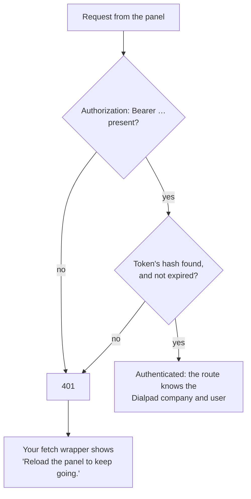

# 5. Authenticate the panel's requests

After the page loads, the panel calls your server many times: the SDK's own two
requests, `ext-connection` and `ext-disconnect`, and every route you add, such as
a contact lookup. The iframe has no idtoken, so each request proves who it's from
with the access token the page handed out ([chapter 3](03-load-the-panel-page.md#hand-out-an-access-token)):

```http
GET /dialpad/ext-connection
Authorization: Bearer <the access token from the page data>
```

## The flow



## In the panel

Send every request through one wrapper around `fetch` that:

- Adds the SDK's `authHeaders()`, which returns
  `{ Authorization: 'Bearer <access token>' }`.
- Shows "Reload the panel to keep going." when the server answers `401`. Nothing
  else fixes a rejected token; a reload gets a new page and a new token.

Pass the same wrapper to `createRightbar({ fetch })`, so the SDK's own requests
go through it too:

```ts
let authHeaders: () => Record<string, string> = () => ({});
export function useAuthHeaders(source: () => Record<string, string>) {
  authHeaders = source; // call with () => rightbar.authHeaders() once the SDK has started
}

export async function api(input: RequestInfo | URL, init?: RequestInit) {
  const headers = new Headers(init?.headers);
  for (const [name, value] of Object.entries(authHeaders())) {
    if (!headers.has(name)) headers.set(name, value);
  }
  const response = await fetch(input, { ...init, headers });
  if (response.status === 401) showReloadNotice();
  return response;
}
```

Keep the access token in memory, never in `localStorage`, and rely on the
page's CSP to keep injected scripts out
([chapter 9](09-security-checklist.md#the-content-security-policy)).

## On the server

Check the token in one place, such as a middleware or a dependency, that turns
the bearer token into the token's user:

1. Read the `Authorization: Bearer` header. Without one, answer `401`.
2. Hash the token and look it up. If it isn't stored, or it has expired, answer
   `401`.
3. Hand the route the Dialpad company and user stored with the token.

A route learns who's asking only from the stored token, never from the idtoken
or the request body. To revoke a token, delete it; the next request gets `401`.

Don't enable cross-origin access (CORS) on these routes. The panel's page and
its requests come from the same server.

A short-lived signed token, such as a JWT, works too, if you'd rather not store
tokens. You give up revoking a token early. The contract only needs _some_
token the panel can send.

## Add your own routes

Your panel needs more than the contract: contact lookups, notes, search, and so
on. Each is an ordinary route on your server, authenticated the same way. In this
app, a route is a file under `server/acme_dialpad_rightbar/endpoints/app/` with a
`register(app, ctx)` function, listed in that folder's `__init__.py`:

```python
@app.get('/api/notes')
async def notes(request: Request) -> HTTPResponse:
  user = ctx.storage.authenticate(request)  # the user's stored user, or None
  if user is None:
    return unauthorized()  # from acme_dialpad_rightbar.responses
  key = user.user_key()  # the Dialpad company and user making the request
  ...
```

Copy `crm/contact.py` to start one. In the panel, call it through the same
`api()` wrapper.

## In this demo

The demo has no database. It keeps the access token in its one signed storage
cookie, and a request must carry both the bearer token and the cookie, holding
the same token. `ctx.storage.authenticate(request)` makes that check, in
`server/acme_dialpad_rightbar/demo/fake_storage.py`. Because the cookie
travels with every request, requiring the header too also guards against
cross-site request forgery. A real app that keeps its access tokens in its
database needs only the header.
[Chapter 11](11-from-demo-to-your-app.md#the-storage-cookie) explains the
cookie.

`client/src/api.ts` is the panel's wrapper, and `App.vue` shows the reload
notice.

---

**Previous:** [4. Build the panel with the SDK](04-build-the-panel.md) ·
**Next:** [6. Connect the user to your service](06-connect-to-the-crm.md) ·
[Contents](../README.md#the-guide)
