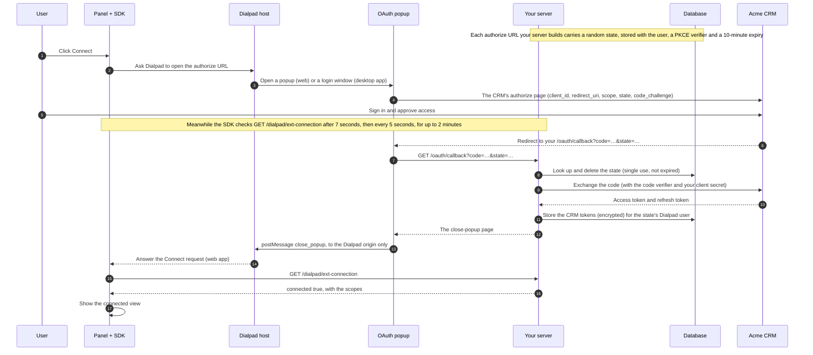
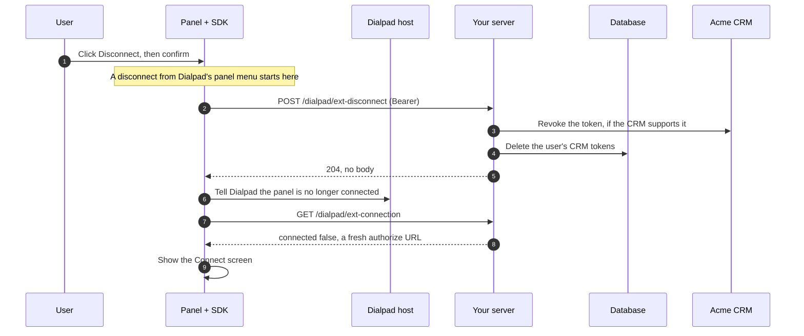

# 6. Connect the user to the CRM

Your panel can't show CRM data until the user links their CRM account to
Dialpad. That's _Connect_: an OAuth flow in a popup, after which your server
holds the user's CRM tokens. This chapter also covers the reverse, _Disconnect_.

## What "connected" means

The user is connected when your server holds CRM tokens for them. It's a fact in
your database, not in a browser, so every panel the user opens, on any device,
agrees about it.

## The connection

Your server reports the connection in two places: in the page data when the page
loads, and from `GET /dialpad/ext-connection` whenever the SDK asks. Both use the
same object:

```json
{
  "connected": false,
  "authorization_urls": { "acme": "https://crm.example/oauth/authorize?…" },
  "name": "acme",
  "scopes": []
}
```

| Field                | What it holds                                                                                               |
| -------------------- | ----------------------------------------------------------------------------------------------------------- |
| `connected`          | Whether you hold CRM tokens for this user                                                                   |
| `authorization_urls` | Where Connect sends the user, by OAuth client name. Required when not connected. Most apps have one client  |
| `name`               | The name of your OAuth client                                                                               |
| `scopes`             | The OAuth scopes the connection has, so the panel can hide what the user can't do. Empty when not connected |

In the panel, `rightbar.state.connection` holds the same information, plus where
Connect is:

| Field               | What it holds                                                                                                                                                        |
| ------------------- | -------------------------------------------------------------------------------------------------------------------------------------------------------------------- |
| `connected`         | The user is connected: show the connected view                                                                                                                       |
| `pending`           | Connect is in progress                                                                                                                                               |
| `authorizationUrls` | `authorization_urls`, as above                                                                                                                                       |
| `name`              | The OAuth client's name                                                                                                                                              |
| `scopes`            | The connection's OAuth scopes                                                                                                                                        |
| `error`             | `null`, or why the last connection request failed: `{ code: 'request_failed', status }`, `{ code: 'network' }`, or `{ code: 'timeout' }`. The next success clears it |

## Connect



### In the panel

Your **Connect** button calls `authorize()`. The SDK does the rest:

1. It asks Dialpad to open the authorize URL, in a popup on the web or a separate
   window in the desktop app, and sets `connection.pending`.
2. It checks `GET /dialpad/ext-connection` after 7 seconds, then every 5 seconds.
   A failed check doesn't end Connect; the next one decides.
3. On the web, the close-popup page tells Dialpad, which answers the SDK, and the
   SDK checks at once. The desktop app's login window can't do that, so there the
   checks finish Connect.
4. When your server answers `connected: true`, the state becomes
   `connected: true, pending: false`. After 2 minutes without that, Connect stops
   with `error: { code: 'timeout' }`; show **Try again**.

When a company has several OAuth clients, `connection.authorizationUrls` has one
entry for each. Show their names and pass the chosen one: `authorize('sandbox')`.

| Call                 | What it does                                                                                                                                                                                                                                  |
| -------------------- | --------------------------------------------------------------------------------------------------------------------------------------------------------------------------------------------------------------------------------------------- |
| `authorize(client?)` | Starts Connect and checks until connected, or for 2 minutes. `client` names the OAuth client; leave it out when there's only one. Does nothing when already connected; starts over when called during Connect                                 |
| `refresh()`          | Asks `GET /dialpad/ext-connection` and updates `connection`. The SDK also calls it at start when the page data says not connected, which picks up a Connect finished in an earlier panel. Never rejects: a failure goes in `connection.error` |

### On your server

The OAuth callback is the one part of Connect on your server:

- **Check the `state`.** Make it random and single use, stored with the Dialpad
  user it was created for. The callback learns who is connecting only from it, so
  a callback can never connect someone else, and a reused or expired one fails.
  Use PKCE as well when the CRM supports it.
- **Exchange the code and store the tokens**, encrypted, for that Dialpad user.
  Never put CRM tokens in a page, a response, or a log.
- **Answer with the close-popup page.** It calls
  `window.opener.postMessage('close_popup', <Dialpad origin>)`, never with `'*'`,
  and only when it has an opener.

`ext-connection` then answers `connected: true`, from the database, on any server
instance. A Connect that finishes after the SDK stops checking shows up at the
next check or page load.

### When Connect goes wrong

| What happens                                              | Result                                                                                   |
| --------------------------------------------------------- | ---------------------------------------------------------------------------------------- |
| The user denies access at the CRM (`error=access_denied`) | The callback shows a short "not connected" page and closes the popup; nothing is stored  |
| The `state` is unknown, used already, or expired          | The callback shows an error page; nothing is stored                                      |
| The code exchange fails                                   | The callback shows an error page; nothing is stored                                      |
| The user never finishes                                   | The SDK stops after 2 minutes; the panel says the CRM didn't respond, with **Try again** |
| A connection check fails (network, non-`2xx` answer)      | The panel shows the matching message (`network`, `request_failed`) with **Try again**    |
| The access token is rejected (`401`)                      | "Reload the panel to keep going." ([chapter 5](05-authenticate-requests.md))             |

## Disconnect

The user disconnects from a **Disconnect** button in your panel, or from
Dialpad's panel menu when your panel lists `disconnect` in it
([chapter 7](07-show-the-crm-record.md#the-panel-menu)). Both take the same
path; the menu skips your confirmation.



| Call           | What it does                                                                                                                                                                           |
| -------------- | -------------------------------------------------------------------------------------------------------------------------------------------------------------------------------------- |
| `disconnect()` | Calls `POST /dialpad/ext-disconnect`, shows the panel as not connected, and calls `onDisconnect`. On failure, `connected` stays as it was and `connection.error` is set. Never rejects |

- **The session survives.** Only the CRM tokens go, so the follow-up check still
  authenticates.
- **It disconnects everywhere.** Other open panels of the same user find out at
  their next request and offer to connect again.
- **`onDisconnect`** (an option of `createRightbar()`) runs after your endpoint
  succeeds, from your button or the menu. Use it to clear CRM data the panel
  holds.
- **Contact mappings are yours to keep or delete.** Keeping them makes a
  reconnect instant. Follow your data-retention rules.
- **The CRM can disconnect the user too.** When a CRM call fails because the user
  revoked access or the refresh token expired, delete the tokens and answer
  "not connected" from then on.

## In this demo

- The OAuth is fake. `/oauth/fake-authorize` is a page labelled fake with an
  **Authorize** button, and `/oauth/callback` only records that the user
  connected. There are no CRM tokens.
- Because the demo has no database, the callback leaves a note in server memory
  that the panel's next check collects, and the session cookie records
  "connected" ([chapter 11](11-from-demo-to-your-app.md#oauth-results-in-memory)).
- `client/src/components/ConnectGate.vue` is the Connect screen, and
  `DisconnectButton.vue` confirms inline. Copy them and change the text.

---

**Previous:** [5. Authenticate the panel's requests](05-authenticate-requests.md) ·
**Next:** [7. Show the CRM record](07-show-the-crm-record.md) ·
[Contents](../README.md#the-guide)
