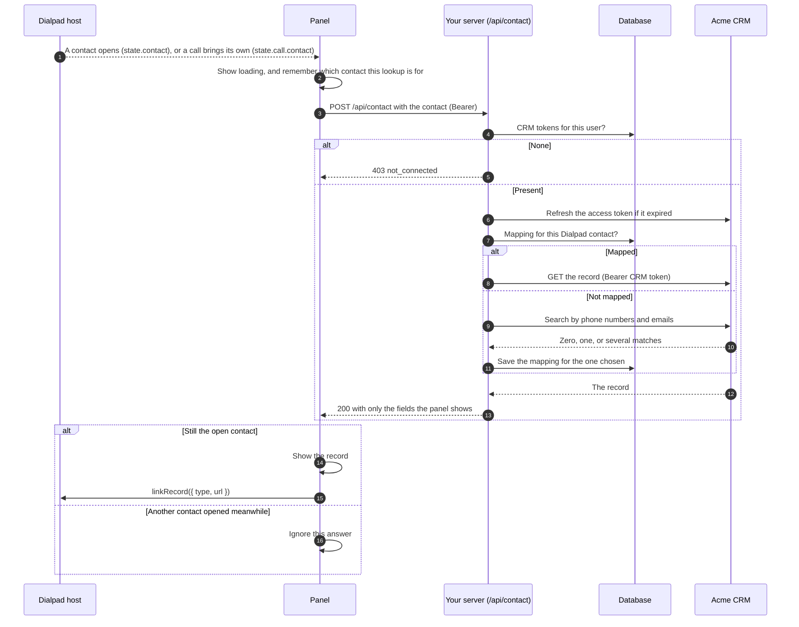
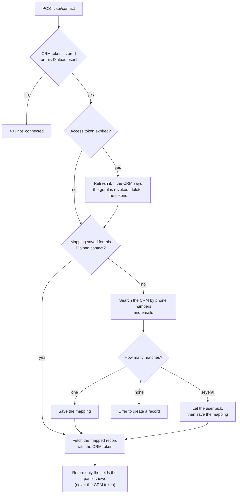

# 7. Show the CRM record

Dialpad tells the panel which contact is open, but that's _Dialpad's_ contact: a
name, phone numbers, and emails from Dialpad's directory. Your panel exists to
show _your_ record for that person. Finding one from the other is the _contact
mapping_, and it runs on your server, because it needs the user's CRM tokens.

## The flow



## On your server

`POST /api/contact` is your own route ([chapter 5](05-authenticate-requests.md#add-your-own-routes)),
not part of the contract, so its path and shape are yours. After authenticating
the request:



1. **Check the connection.** No CRM tokens means not connected: answer `403`, and
   the panel offers to connect.
2. **Map the contact.** Look in your mapping table first. Otherwise, search the
   CRM by the contact's phone numbers and emails, in the form the CRM stores
   (usually E.164 phone numbers and lowercase emails), and decide what zero, one,
   and several matches mean. Save the choice.
3. **Fetch the record** with `Authorization: Bearer <CRM access token>`. Return
   only the fields the panel shows, and the record's type and URL in the CRM, for
   [`linkRecord`](#link-the-record-in-dialpad).
4. **Handle a slow or failing CRM** with a short timeout and an error the panel
   can show.

## In the panel

- **Ignore late answers.** The user can open another contact before the lookup
  finishes. Number each lookup, and show an answer only if it belongs to the
  latest one.
- **Show both contacts during a call when they differ.** There can be two: the
  panel's (`state.contact`) and the call's own (`state.call.contact`). Usually
  they're the same person, and one section is enough.
- **Show loading and failure.** This app also shows an error toast when a lookup
  fails.

## Link the record in Dialpad

Once the panel has the record, tell Dialpad about it with `linkRecord`:

```ts
await rightbar.linkRecord({
  type: "Contact",
  url: "https://crm.example/contacts/42",
});
await rightbar.linkRecord(null); // unlink, for example when another contact opens
```

Dialpad then:

- Shows the record in the panel's header, which opens `url` in a new tab: a
  **View Contact** link (with your `type`), a ↗ button that appears when the
  pointer is over the header, or both; Dialpad decides which a user sees. They
  show whenever a record is linked, whatever the panel menu holds.
- Uses `url` as the default for screen pops (below).

Unlink with `linkRecord(null)` as soon as the contact changes, when the lookup
fails, and when the user disconnects, so Dialpad never shows a record for another
contact. Link only the panel's own contact, not a call's other contact: Dialpad
keeps one linked record per panel.

### The panel menu

The panel menu is Dialpad's menu in your panel's header. Your panel decides what
it holds with `setMenu`: each item is an `id` of your choice and the `label`
Dialpad shows. When the user picks an item, the SDK emits `menuSelect` with its
`id`:

```ts
await rightbar.setMenu([]); // no menu, before the user connects
await rightbar.setMenu([
  { id: "rematch", label: "Rematch" },
  { id: "disconnect", label: "Disconnect" },
]); // once the user connects

rightbar.on("menuSelect", (id) => {
  if (id === "disconnect") rightbar.disconnect();
  if (id === "rematch") rematch(); // yours: see Rematch below
});
```

- **Dialpad shows exactly your items**, in your order, and adds nothing. List a
  Disconnect item yourself whenever the user should be able to disconnect from
  the menu, and call `disconnect()` when they pick it
  ([chapter 6](06-connect-to-the-crm.md#disconnect)).
- **Dialpad doesn't check the connection.** Set `[]` while the user isn't
  connected.
- **Set it every time the panel starts.** Dialpad forgets the menu when the panel
  reloads, so set it from the connection state, as this app does. A panel that
  never calls `setMenu` has no menu.
- **The labels are yours to translate**
  ([chapter 4](04-build-the-panel.md#translate-the-panel)). Dialpad shows them
  as plain text, never as HTML, and cuts one that doesn't fit with an ellipsis.

Dialpad holds the menu to these limits:

| What            | Limit                                                   | When it's broken                                                         |
| --------------- | ------------------------------------------------------- | ------------------------------------------------------------------------ |
| The items       | A list of at most 5                                     | Dialpad refuses the menu: `setMenu` rejects and the menu stays as it was |
| An item's `id`  | 1 to 64 characters, and not the `id` of an earlier item | Dialpad leaves the item out, and the SDK logs a warning naming its `id`  |
| An item's label | 1 to 40 characters, not only spaces                     | The same                                                                 |

What to offer depends on your CRM. For example:

| Item        | Offer it when                                         | What your panel does when it's picked                                             |
| ----------- | ----------------------------------------------------- | --------------------------------------------------------------------------------- |
| Disconnect  | The user is connected                                 | Calls `disconnect()` ([chapter 6](06-connect-to-the-crm.md#disconnect))           |
| Rematch     | A record is linked, and your server maps contacts     | Forgets the saved mapping and looks the contact up again ([Rematch](#rematch))    |
| Create Task | A record is linked, and the CRM has tasks or activity | Creates a task in the CRM against the linked record ([Create Task](#create-task)) |

| Call                                             | What it does                                                                                        |
| ------------------------------------------------ | --------------------------------------------------------------------------------------------------- |
| `linkRecord({ type, url })` / `linkRecord(null)` | Tells Dialpad which of your records matches the open contact, or unlinks it                         |
| `setMenu(items)`                                 | Sets the panel menu to `items`, each `{ id, label }`, in order. Resolves once Dialpad answers       |
| `on('menuSelect', callback)`                     | Runs `callback(id)` when the user picks an item in the panel menu. Returns a function that stops it |
| `screenPop({ url?, force? })`                    | Asks Dialpad to open a record for the active call, by default the linked record's URL               |

### Rematch

The contact mapping can pick the wrong record, for example when two records
share a phone number. **Rematch** lets the user ask for the match again:

1. When the user picks Rematch, your panel asks a route of your own to delete
   the saved mapping for the open contact.
2. The panel unlinks the record and runs the lookup again. With no saved mapping,
   your server searches the CRM afresh, as in step 2 of
   [On your server](#on-your-server), and lets the user pick when there are
   several matches.
3. The panel links the new record.

```ts
rightbar.on("menuSelect", async (id) => {
  const contact = rightbar.state.contact;
  if (id !== "rematch" || !contact) return;
  await forgetMapping(contact); // your route: delete the saved mapping
  await rightbar.linkRecord(null);
  await lookUp(contact); // the same lookup as when the contact changes
});
```

Offer Rematch only once a record is linked: before that, there's no match to
redo.

### Create Task

**Create Task** creates a task in the CRM against the linked record, such as a
call back. The menu item only tells your panel that the user asked. Show a
short form inline in the panel (a dialog can't leave the iframe), then post it
to a route of your own, which creates the task with the user's CRM token:

```ts
rightbar.on("menuSelect", (id) => {
  if (id === "create-task") {
    showTaskForm.value = true; // your form posts to your route, such as POST /api/tasks
  }
});
```

### Refresh the record

Dialpad's refresh button, in the panel's header, lets the user ask for the CRM's
latest. Show it with `showRefreshButton(true)` once the user connects, and hide
it with `showRefreshButton(false)` when they disconnect. When the user presses
it, the SDK reloads `state.contact` and then emits `refreshContact`.

The SDK keeps the same `state.contact` object when the reloaded contact hasn't
changed, so a watch on the contact doesn't run. Look the contact up again in the
`refreshContact` callback instead. The SDK also emits `refreshContact` when
Dialpad changes the contact, and your watch already looks that one up, so skip
the lookup when the contact changed since the last `refreshContact`:

```ts
let lastContact = rightbar.state.contact;
rightbar.on("refreshContact", () => {
  const contact = rightbar.state.contact;
  const unchanged = contact === lastContact;
  lastContact = contact;
  if (unchanged && contact) {
    lookUp(contact); // the same lookup as when the contact changes
  }
});
```

### Screen pops

A _screen pop_ opens the caller's record when a call comes in.
`rightbar.screenPop()` asks Dialpad to open the linked record's URL, or the `url`
you pass. Without `force`, Dialpad pops only when the user has screen pops turned
on, during a live inbound call, at most once per call, and not for an office or
department contact.

## In this demo

- There's no CRM, so there's no mapping. `POST /api/contact`
  (`server/acme_dialpad_rightbar/endpoints/app/contact.py`) returns every
  non-empty field of the Dialpad contact with an `Acme ` prefix. That proves the
  contact reached the server and came back, for the right user. The route's
  docstring describes what a real one does.
- The route also returns a record to link: a page labelled fake at
  `/records/<contact id>` (`server/acme_dialpad_rightbar/fake_record.py`), which
  stands in for the CRM's page for the record and shows only the contact's ID.
- `client/src/components/AcmeContact.vue` runs the lookup, shows loading and
  failure, and ignores late answers. Once the lookup succeeds, it links the
  record, and it unlinks as described above.
- `client/src/bootstrap.ts` sets the panel menu from the connection: `[]` before
  the user connects, and **Rematch**, **Create Task**, and **Disconnect** once
  connected. Its labels are English only. Picking **Disconnect** disconnects.
  The demo has no mapping and no tasks, so picking **Rematch** or **Create
  Task** only shows a toast saying the sample app doesn't implement it. A real
  app offers each only when it can act on it, as in the table above.
- `bootstrap.ts` also shows the refresh button while the user is connected.
  When the user presses it, `AcmeContact.vue` looks the contact up again, as
  described in [Refresh the record](#refresh-the-record).

---

**Previous:** [6. Connect the user to the CRM](06-connect-to-the-crm.md) ·
**Next:** [8. Call Dialpad's API and receive events](08-call-dialpad.md) ·
[Contents](../README.md#the-guide)
