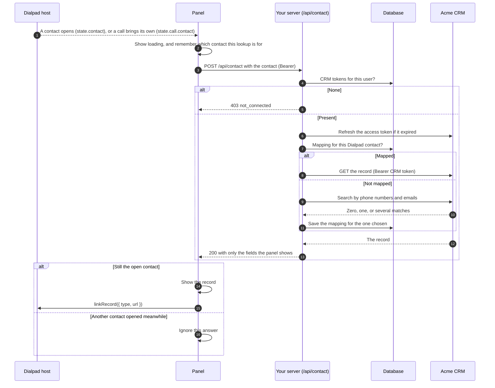
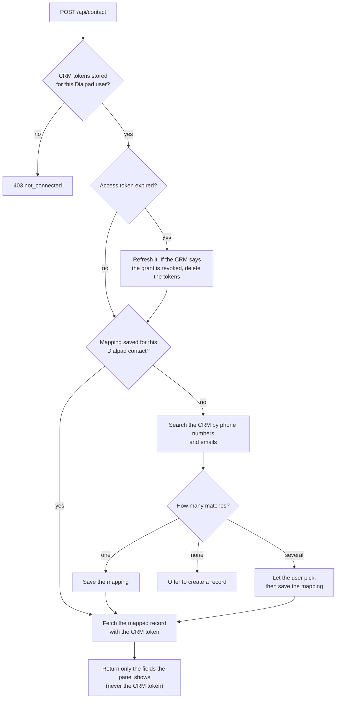

# 7. Show the CRM record

> **For CRM apps.** This chapter is for a panel that shows the open contact's
> record in a CRM, or in another system that keeps its own records of people. A
> panel that doesn't, such as one about the call, can skip it. Dialpad's header
> controls, which every panel can use, are in
> [chapter 4](04-build-the-panel.md#use-dialpads-ui).

Dialpad tells the panel which contact is open, but that's _Dialpad's_ contact: a
name, phone numbers, and emails from Dialpad's directory. Your panel exists to
show _your_ record for that person. Finding one from the other is the _contact
mapping_, and it runs on your server, because it needs the user's CRM tokens.

## The flow



## On your server

`POST /api/contact` is your own route ([chapter 5](05-authenticate-requests.md#add-your-own-routes)),
not part of the contract, so its path and shape are yours. After authenticating
the request:



1. **Check the connection.** No CRM tokens means not connected: answer `403`, and
   the panel offers to connect.
2. **Map the contact.** Look in your mapping table first. Otherwise, search the
   CRM by the contact's phone numbers and emails, in the form the CRM stores
   (usually E.164 phone numbers and lowercase emails), and decide what zero, one,
   and several matches mean. Save the choice.
3. **Fetch the record** with `Authorization: Bearer <CRM access token>`. Return
   only the fields the panel shows, and the record's type and URL in the CRM, for
   [`linkRecord`](#link-the-record-in-dialpad).
4. **Handle a slow or failing CRM** with a short timeout and an error the panel
   can show.

## In the panel

- **Ignore late answers.** The user can open another contact before the lookup
  finishes. Number each lookup, and show an answer only if it belongs to the
  latest one.
- **Show both contacts during a call when they differ.** There can be two: the
  panel's (`state.contact`) and the call's own (`state.call.contact`). Usually
  they're the same person, and one section is enough.
- **Show loading and failure.** This app also shows an error toast when a lookup
  fails.

## Link the record in Dialpad

Dialpad's panel header has three controls
([chapter 4](04-build-the-panel.md#use-dialpads-ui)). This section shows how a CRM
panel uses them.

Once the panel has the record, set it as the View link, with the type and URL
your server returned:

```ts
await rightbar.linkRecord({
  type: "Contact",
  url: "https://crm.example/contacts/42",
});
```

Dialpad shows a **View Contact** link that opens the record in the CRM. Unlink
with `linkRecord(null)` as soon as the contact changes, when the lookup fails,
and when the user disconnects.

### Rematch

The contact mapping can pick the wrong record, for example when two records
share a phone number. **Rematch**, an item in the panel menu
([chapter 4](04-build-the-panel.md#the-panel-menu)), lets the user ask for the
match again:

1. When the user picks Rematch, your panel asks a route of your own to delete
   the saved mapping for the open contact.
2. The panel unlinks the record and runs the lookup again. With no saved mapping,
   your server searches the CRM afresh, as in step 2 of
   [On your server](#on-your-server), and lets the user pick when there are
   several matches.
3. The panel links the new record.

```ts
rightbar.on("menuSelect", async (id) => {
  const contact = rightbar.state.contact;
  if (id !== "rematch" || !contact) return;
  await forgetMapping(contact); // your route: delete the saved mapping
  await rightbar.linkRecord(null);
  await lookUp(contact); // the same lookup as when the contact changes
});
```

Offer Rematch only once a record is linked: before that, there's no match to
redo.

### Create Task

**Create Task** in the panel menu creates a task, such as a call back, against
the linked record. Your route creates it with the user's CRM token. Offer it
once a record is linked and the CRM has tasks or activity.

### Refresh the record

The refresh button lets the user ask for the CRM's latest record. Show it once
the user connects. In the `refreshContact` callback, run the same lookup as when
the contact changes, following
[chapter 4](04-build-the-panel.md#the-refresh-button).

### Screen pops

A _screen pop_ opens the caller's record when a call comes in.
`rightbar.screenPop({ url?, force? })` asks Dialpad to open the linked record's
URL, or the `url` you pass. Without `force`, Dialpad pops only when the user has
screen pops turned on, during a live inbound call, at most once per call, and
not for an office or department contact.

## In this demo

- There's no CRM, so there's no mapping. `POST /api/contact`
  (`server/acme_dialpad_rightbar/endpoints/app/contact.py`) returns every
  non-empty field of the Dialpad contact with an `Acme ` prefix. That proves the
  contact reached the server and came back, for the right user. The route's
  docstring describes what a real one does.
- The route also returns a record to link: a page labelled fake at
  `/records/<contact id>` (`server/acme_dialpad_rightbar/fake_record.py`), which
  stands in for the CRM's page for the record and shows only the contact's ID.
- `client/src/components/AcmeContact.vue` runs the lookup, shows loading and
  failure, and ignores late answers. Once the lookup succeeds, it links the
  record in `setLinkedRecord()`, and it unlinks as described above. Its
  `refreshContact` callback looks the contact up again, as described in
  [Refresh the record](#refresh-the-record).
- `client/src/bootstrap.ts` sets the menu and the refresh button. The demo's
  **Rematch** and **Create Task** only show a toast
  ([chapter 4](04-build-the-panel.md#in-this-demo)).

---

**Previous:** [6. Connect the user to the CRM](06-connect-to-the-crm.md) ·
**Next:** [8. Call Dialpad's API and receive events](08-call-dialpad.md) ·
[Contents](../README.md#the-guide)
