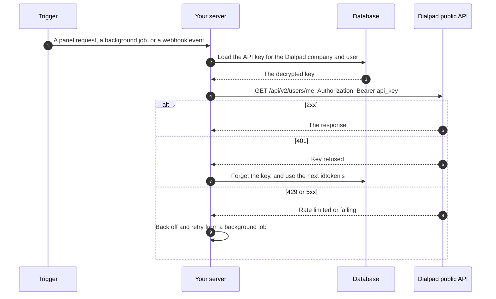
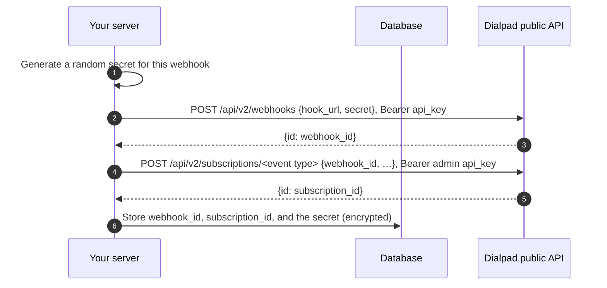
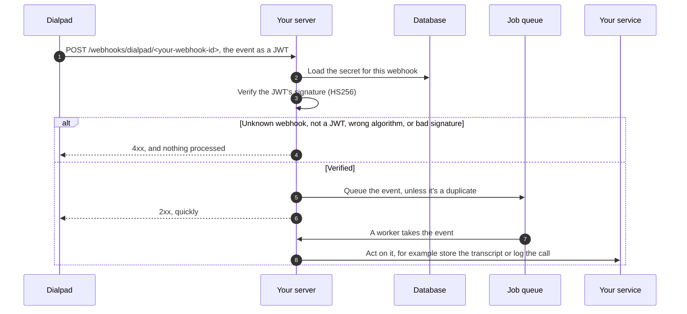

# 8. Call Dialpad's API and receive events

Your server can work with Dialpad directly: call Dialpad's public API, and have
Dialpad send it events, such as a finished call to log on the CRM record, or a
call's AI transcript to show in the panel. Both work when no panel is open.
[developers.dialpad.com](https://developers.dialpad.com/) documents every API
endpoint and every event you can subscribe to.

## Call Dialpad's API

Your server calls Dialpad's public API with the user's API key, which it stored
from the idtoken ([chapter 3](03-load-the-panel-page.md#keep-the-api-key)):

```http
GET https://dialpad.com/api/v2/users/me
Authorization: Bearer <api_key>
```



- **Only your server has the key.** The browser never calls Dialpad's API. What
  the panel needs from Dialpad, such as the user, the contact, and the call,
  arrives through the SDK.
- **Use a client library.** Dialpad's own clients add the header for you; for
  Python, [`python-dialpad`](https://pypi.org/project/python-dialpad/).
- **Check whose key an endpoint needs.** The key belongs to one user and your app.
  Some endpoints need more, such as a company admin's key for event
  subscriptions.
- **Respect the limits.** Each endpoint documents a rate limit, for example 100 a
  minute for creating a webhook. On a request path, use a short timeout and no
  retries, and retry with backoff from a background job. Treat a `401` as "this
  key was refused".

[developers.dialpad.com](https://developers.dialpad.com/) documents every endpoint
and its rate limit.

## Receive Dialpad's events

Dialpad can send events to a URL on your server, a _webhook_, so your app
learns what happens in Dialpad without asking. You subscribe to the kinds of
event your app needs, and Dialpad sends each one as it happens. Because Dialpad
calls you, you must check that each request really came from Dialpad. See
Dialpad's
[Event Subscriptions](https://developers.dialpad.com/docs/event-subscriptions)
guide.

Some tasks, and the events behind them
([Call Events](https://developers.dialpad.com/docs/call-events) lists the call
states):

| Your app wants to                      | Subscribe to                                                                                             |
| -------------------------------------- | -------------------------------------------------------------------------------------------------------- |
| Log a finished call on a record        | Call events, and act on the `hangup` state                                                               |
| Show or store a call's transcript      | Call events. The `call_transcription` state says a transcript is ready to fetch with the transcripts API |
| Show or store a call's AI recap        | Call events. The `recap_summary` state carries the recap                                                 |
| Log text messages                      | SMS events                                                                                               |
| Keep contacts in step with your system | Contact events                                                                                           |
| React to an agent's availability       | Agent status events                                                                                      |

Events reach your server, not the panel. To show an event's result in the
panel, store it, and have the panel fetch it from your server through a route of
its own ([chapter 5](05-authenticate-requests.md#add-your-own-routes)).

### Set up a webhook



- **A webhook** is a URL and a secret. **A subscription** sends one kind of event
  (calls, SMS, contacts, or agent status, optionally filtered) to a webhook. One
  webhook can serve several subscriptions. See
  [Webhook Create](https://developers.dialpad.com/reference/webhookscreate) and
  [Subscriptions](https://developers.dialpad.com/reference/subscriptions).
- **The secret is yours.** Generate a random string and give it to Dialpad when
  you create the webhook. It's not the API key. Dialpad recommends a different
  secret for each subscription, so a leak exposes only one.
- **Always provide a secret.** Without one, Dialpad sends plain JSON, and anyone
  who finds your URL can forge events.
- **Give each webhook its own path**, such as `/webhooks/dialpad/<your-webhook-id>`,
  so your server knows which secret to use before it reads anything.

### Handle an event

Dialpad sends each event as a JWT signed with your secret (`HS256`):



1. **Pick the secret from the URL**, never from inside the unverified JWT.
2. **Accept only `HS256`**, and verify the signature before you look at the
   payload. Use your JWT library's verify call, such as
   `jwt.decode(token, secret, algorithms=["HS256"])`.
3. **Validate the payload's shape** before you use it, as with any input.
4. **Make processing safe to repeat**, so a repeated delivery does no harm. Key it
   on the event's identity, such as a call's ID and state.
5. **Answer fast and work later.** Return `2xx` once the event is queued, and do
   the work in a background worker.
6. **Don't log the body or the secret.** Log the webhook ID and the outcome.
7. **Rotate a secret by replacing the webhook:** create a new one with a new
   secret, point the subscriptions at it, then delete the old one.

## In this demo

- The demo makes one call to Dialpad's API, `GET /api/v2/users/me`, while it
  renders the page, then drops the key. The panel shows the result in its "From
  Dialpad's API" card ([chapter 11](11-from-demo-to-your-app.md#the-demo-call-to-dialpads-api)).
- It has no webhooks and no subscriptions.

---

**Previous:** [7. Show the CRM record](07-show-the-crm-record.md) ·
**Next:** [9. Security checklist](09-security-checklist.md) ·
[Contents](../README.md#the-guide)
